<!--
DAY 1 SESSION PLAN (90 min). Agreed direction: classroom/restructure-proposal.md.
Outcomes: explain likelihood/prior/posterior in words; predict how data/prior changes
alter a posterior.
Assume basic R execution, daytime GLM practice, English and no homework. Confirm
language, prior experience and the prepared browser environment with organisers.
0-8 setup/course question; 8-23 likelihood; 23-43 fip/PCR/Bayes;
43-58 prior/posterior/coins; 58-70 ONE exercise (8 work + 4 debrief);
70-80 Stan demonstration; 80-85 reflection; 85-90 questions/buffer.
Core: familiar examples and one figure-comparison exercise. Draw calculations,
MLE differentiation, detailed estimators and MH/HMC are optional.
If delayed, shorten Stan demonstration. Keep exercise debrief and questions.
-->

```{r setup, include=FALSE}
source(here::here("R/slides_setup.R"))
```

##  {#title-slide background="../images/priors.png" background-size="50%" background-position="50% 20%"}

::: title-box
<h2>Bayesian statistics for ecology</h2>

<h3>Day 1: From likelihood to posterior</h3>

<p>AFEC-X 2026 · 21 October</p>

<h3>🧑🏻‍💻 [Masatoshi Katabuchi \@ XTBG, CAS]{.author}</h3>
:::


## Course map

::: columns
::: {.column width="33%"}
### Day 1

**Bayesian foundations**

- Likelihood
- Bayes' theorem
- Prior and posterior
- Completed Stan model and results
:::

::: {.column width="33%"}
### Day 2

**Regression and model checking**

- Seedling survival and CNDD
- Posterior prediction
- Did the model and the computation work?
:::

::: {.column width="33%"}
### Day 3

**Hierarchical models**

- Partial pooling
- Mother trees and information sharing
- Workflow for real ecological data
:::
:::

::: fragment
::: small
- Each day: short lectures + one exercise in the browser-based R environment.
- The goal is to explain Bayesian ideas, read figures and connect models to ecological questions.
- Core tasks use supplied posterior draws.
  The instructor may demonstrate live sampling.
:::
:::

::: notes
- 3 x 90 minutes
- nobody needs to install anything; work in pairs and swap driver/reader roles
:::

## {#where-we-are-going}

::: columns
::: {.column width="40%"}
{height=480}
:::

::: {.column width="60%"}
### Conspecific negative density dependence (CNDD)

"...rare species suffered more from the presence of conspecific neighbors than common species did, suggesting that conspecific density dependence shapes species abundances in diverse communities."

\-                    Comita et al. 2010 \-

:::
:::

::: fragment
Our question: does conspecific density affect survival differently among species?
:::

::: fragment
**Where we are going**: by Day 3, we can describe the model structure behind this question.
:::

::: footer
[Comita *et al.* 2010 *Science*](https://doi.org/10.1126/science.1190772)
:::

::: notes
- motivation only: no model details today
- most questions in community ecology have this shape: individuals within species (or sites, or years)
:::

## Today's question: the smallest version

::: columns
::: {.column width="40%"}

:::

::: {.column width="60%"}
We planted 5 seedlings.
One year later, 2 are alive.

::: incremental
- What is the survival probability $p$ of this species?
- How sure are we?
- Would we be equally sure with 40 survivors out of 100?
:::

::: fragment
One species, no predictor, one parameter.
We start with this simple model of one survival probability.
On Day 2, survival probability depends on conspecific density.
On Day 3, survival rates vary among mother trees and species.
:::
:::
:::

## Today's objectives

- Explain likelihood, prior and posterior using a figure.
- Predict how changing data or the prior changes the posterior.

::: notes
Ask for explanations in words. Independent implementation is an optional extension.
:::

# Likelihood

<!-- Normal examples adapted from main.qmd at commit 3013b7c. -->

## Normal model: from parameters to data

$$\boxed{f(\text{data}\mid\text{parameters})}$$

Probability density of the data given the parameters.

::: columns
::: {.column width="50%"}
```{r, fig.height=4.5, fig.width=7}
normal_observations <- tibble(x = c(-1.5, 0, 1.5))
x <- seq(-5, 5, length.out = 501)
y <- dnorm(x, mean = 0, sd = 1)
tibble(x, y) |>
  ggplot(aes(x, y)) +
  geom_line(linewidth = 1.5, colour = col_like) +
  geom_segment(
    data = normal_observations,
    aes(x = x, xend = x, y = 0, yend = dnorm(x, mean = 0, sd = 1)),
    inherit.aes = FALSE, linetype = 3
  ) +
  geom_point(
    data = normal_observations,
    aes(x, dnorm(x, mean = 0, sd = 1)),
    inherit.aes = FALSE, size = 4, colour = col_like
  ) +
  geom_rug(data = normal_observations, aes(x = x), inherit.aes = FALSE, sides = "b") +
  labs(x = "Observed value x", y = "Density", title = "Mean = 0, SD = 1")
```
:::
::: {.column width="50%"}
Three observations: $x=\{-1.5,\;0,\;1.5\}$.

::: incremental
- Suppose the mean is $\mu=0$ and the standard deviation is $\sigma=1$.
- How high is the curve at each observed value?
- For continuous data, this height is a **probability density**.
:::
:::
:::

::: notes
- The original Normal examples and data come from main.qmd at commit 3013b7c.
- The vertical bar means "given": evaluate the data under specified parameter values.
- The marks on the horizontal axis show the observed data; the dots on the curve show their densities.
- Assume the three observations are independent and follow the same Normal model.
- Throughout the course, Normal(mu, sigma) uses the standard deviation as its second argument, as in Stan and dnorm().
- Density is not the probability of observing an exact value; for continuous data, probabilities are areas over intervals.
- The displayed notation f(data | parameters) means the joint density; this plot shows each observation's density before combining them on the next slide.
:::

## Normal model: from data to likelihood

::: columns
::: {.column width="50%"}
```{r, fig.height=4.5, fig.width=7}
# Use the original likelihood calculation from main.qmd at 3013b7c.
like_fun <- function(mu) {
  dnorm(-1.5, mean = mu, sd = 1, log = TRUE) +
    dnorm(0, mean = mu, sd = 1, log = TRUE) +
    dnorm(1.5, mean = mu, sd = 1, log = TRUE)
}
normal_comparison <- crossing(x = seq(-5, 5, length.out = 501), mu = c(0, 2)) |>
  mutate(density = dnorm(x, mean = mu, sd = 1), model = factor(mu))
normal_point_densities <- crossing(normal_observations, mu = c(0, 2)) |>
  mutate(density = dnorm(x, mean = mu, sd = 1), model = factor(mu))
normal_density_plot <- ggplot(normal_comparison, aes(x, density, colour = model, linetype = model)) +
  geom_line(linewidth = 1.2) +
  geom_point(data = normal_point_densities, size = 3) +
  geom_rug(data = normal_observations, aes(x = x), inherit.aes = FALSE, sides = "b") +
  scale_colour_manual(values = c("0" = col_like, "2" = "grey50"), labels = c("Mean = 0", "Mean = 2")) +
  scale_linetype_manual(values = c("0" = "solid", "2" = "dashed"), labels = c("Mean = 0", "Mean = 2")) +
  labs(x = "Observed value x", y = "Density", colour = NULL, linetype = NULL) +
  theme(legend.position = "top", legend.text = element_text(size = 18),
        axis.title = element_text(size = 22), axis.text = element_text(size = 18))
normal_likelihood <- tibble(mu = seq(-5, 5, length.out = 501)) |>
  mutate(log_likelihood = like_fun(mu), likelihood = exp(log_likelihood - max(log_likelihood)))
normal_likelihood_plot <- ggplot(normal_likelihood, aes(mu, likelihood)) +
  geom_line(linewidth = 1.5, colour = col_like) +
  geom_vline(xintercept = 0, linetype = 3) +
  labs(x = expression("Mean " * mu), y = "Likelihood (rescaled)") +
  theme(axis.title = element_text(size = 22), axis.text = element_text(size = 18))
normal_density_plot
```
:::
::: {.column width="50%"}
Keep the three observations fixed.

::: incremental
- Keep $\sigma=1$ and move the mean $\mu$.
- For each $\mu$, multiply the densities at the three observed values.
- This gives the **likelihood** $L(\mu)$.
:::

::: fragment
::: small
$$L(\mu)=f(-1.5\mid\mu,1)\,f(0\mid\mu,1)\,f(1.5\mid\mu,1)$$
:::

Which mean fits these observations best?

Compare $\mu=0$ and $\mu=2$. Explain your prediction to your partner.
:::
:::
:::

::: notes
- This graph compares means 0 and 2, with SD fixed at 1; the observed x values stay in the same places.
- Allow about 30 seconds to predict and a brief pair explanation before the R comparison.
- The prediction, R comparison and likelihood-curve explanation use about 3 minutes of the existing 8-23 minute likelihood block, not an additional code exercise.
- Multiplying the densities is justified by the independence assumption.
:::

## Compare the two means in R

Keep $x=\{-1.5,\;0,\;1.5\}$ and $\sigma=1$ fixed. Change only the mean.

`log=TRUE` returns log densities. Their sum is the **log-likelihood**.

::: columns
::: {.column width="50%"}
### Mean = 0

```{r normal-loglik-0, echo=TRUE, results="hide"}
dnorm(-1.5, mean = 0, sd = 1, log = TRUE) +
  dnorm(0, mean = 0, sd = 1, log = TRUE) +
  dnorm(1.5, mean = 0, sd = 1, log = TRUE)
```

::: fragment
```{r normal-loglik-0-result, echo=FALSE}
like_fun(0)
```
:::
:::
::: {.column width="50%"}
### Mean = 2

```{r normal-loglik-2, echo=TRUE, results="hide"}
dnorm(-1.5, mean = 2, sd = 1, log = TRUE) +
  dnorm(0, mean = 2, sd = 1, log = TRUE) +
  dnorm(1.5, mean = 2, sd = 1, log = TRUE)
```

::: fragment
```{r normal-loglik-2-result, echo=FALSE}
like_fun(2)
```
:::
:::
:::

::: fragment
Which value is larger (less negative)? **Mean = 0 fits these data better.**

Taking logs preserves the ordering: larger likelihood, larger log-likelihood.
:::

::: notes
- Restore the explicit dnorm calculation from main.qmd, with short lines for readability.
- Ask what stays fixed and which argument changes. Participants may read the code and explain their prediction; running it is optional.
- Reveal the two values only after the pair explanation: about -5.007 and -11.007.
- These are log-likelihoods, not probabilities or posterior probabilities of the two means.
- The dnorm terms are densities. Independence makes their product the joint likelihood; taking logs turns the product into a sum.
- A larger log-likelihood is better here even though both values are negative. No log derivation, derivative or optimisation code is required.
:::

## From two means to a likelihood curve

::: columns
::: {.column width="55%"}
```{r normal-likelihood-curve, fig.height=4.5, fig.width=7}
normal_likelihood_plot
```
:::
::: {.column width="45%"}

- Repeat the same calculation for many values of $\mu$.
- Keep the observations and $\sigma=1$ fixed throughout.
- The likelihood is highest at $\mu=0$ for these data.

This curve compares possible means using the same observations.
:::
:::

::: notes
- This curve appears after the prediction and numerical comparison, so it does not reveal the answer first.
- The computation sums log densities, then exponentiates after subtracting the maximum. The displayed likelihood is rescaled to a maximum of one.
- Rescaling does not change relative likelihoods or the position of the maximum. It does not make this a probability distribution for mu.
- Connect to the next slide: for seedling counts we compare p instead of the Normal mean, using a binomial likelihood.
:::

## Binomial MLE: back to the seedlings

::: columns
::: {.column width="50%"}
```{r, fig.height=5, fig.width=7}
seedling_likelihood <- tibble(p = seq(0, 1, length.out = 501)) |>
  mutate(likelihood = dbinom(2, size = 5, prob = p))
seedling_likelihood_plot <- ggplot(seedling_likelihood, aes(p, likelihood)) +
  geom_line(linewidth = 1.5, colour = col_like) +
  labs(x = "Survival probability p", y = "Likelihood", title = "2 survivors out of 5")
seedling_likelihood_plot +
  geom_vline(xintercept = 0.4, linetype = 3, colour = col_like) +
  annotate("point", x = 0.4, y = dbinom(2, 5, 0.4), size = 4, colour = col_like)
```
:::
::: {.column width="50%"}
We return to **two survivors out of five**.

::: incremental
- Now compare survival probabilities $p$ instead of Normal means $\mu$.
- The likelihood is highest at $p=0.4$.
- This is the **maximum likelihood estimate** (MLE).
:::

::: fragment
$$L(p)=P(Y=2\mid p)=\binom{5}{2}p^2(1-p)^3$$

$$\hat{p}_{\mathrm{MLE}}=\frac{2}{5}=0.4$$
:::
:::
:::

::: notes
- The data stay fixed, just as in the Normal example; now the parameter is a survival probability.
- For a discrete count, use the probability P(Y=2 | p), rather than a density.
- Assume five independent seedlings with the same survival probability p.
- The MLE makes the observed two survivors most likely under this model.
:::

## What the MLE does not tell us

::: columns
::: {.column width="55%"}
```{r, fig.height=6, fig.width=8}
tibble(p = seq(0, 1, length.out = 501)) |>
  mutate(
    `2 of 5` = dbinom(2, 5, p) / max(dbinom(2, 5, p)),
    `40 of 100` = dbinom(40, 100, p) / max(dbinom(40, 100, p))
  ) |>
  pivot_longer(-p, names_to = "Data", values_to = "lik") |>
  ggplot(aes(p, lik, linetype = Data)) +
  geom_line(linewidth = 1.5, colour = col_like) +
  geom_vline(xintercept = 0.4, linetype = 3) +
  labs(x = "Survival probability p", y = "Likelihood (rescaled)") +
  theme(legend.position = "top")
```
:::

::: {.column width="45%"}
::: incremental
- Both data sets give the same MLE: $\hat{p} = 0.4$.
- With 2 of 5, values such as $p = 0.2$ or $p = 0.7$ are still very compatible with the data.
- A single number hides this uncertainty.
- What we really want: **how plausible is each value of $p$, given the data?**
  $$P(p \mid \text{data})$$
:::
:::
:::

::: notes
- the likelihood is P(data | p), not P(p | data)
- to turn it around we need Bayes' theorem
:::

# Conditional Probability and Bayes' Theorem

## Conditional Probability

::: columns

::: {.column width="40%"}

```{r}
circle <- function(x0, y0, r, n = 200) {
  t <- seq(0, 2 * pi, length.out = n)
  tibble(x = x0 + r * cos(t), y = y0 + r * sin(t))
}
a <- 1
radius <- 1.5
lens <- bind_rows(
  circle(-a, 0, radius) |> filter(x >= 0) |> arrange(y),
  circle(a, 0, radius) |> filter(x <= 0) |> arrange(desc(y))
)

ggplot() +
  geom_polygon(data = circle(a, 0, radius), aes(x, y), fill = "blue", alpha = 0.3) +
  geom_polygon(data = lens, aes(x, y), fill = "blue", alpha = 0.6) +
  geom_path(data = circle(-a, 0, radius), aes(x, y), linewidth = 1.5) +
  geom_path(data = circle(a, 0, radius), aes(x, y), linewidth = 1.5) +
  ggtitle("U") +
  coord_fixed() +
  theme_void() +
  annotate("text", x = 0, y = 0, label = "A ∩ B", size = 14) +
  annotate("text", x = -1.5, y = 0, label = "A", size = 16) +
  annotate("text", x = 1.5, y = 0, label = "B", size = 16) +
  theme(
    title = element_text(size = 40),
    panel.border = element_rect(colour = "black", linewidth = 2, fill = NA),
    legend.position = "none"
  )
```

:::

::: {.column width="60%"}

Probability of A occurring given B has already occurred:

$$
P(A \mid B) = \frac{P(A \cap B)}{P(B)}
$$

::: incremental
e.g.,

- P(hangover) = 4%
- P(baijiu) = 1.5%
- P(hangover | baijiu) = 85%.
:::

:::
:::

::: notes
- probability A occurs given B
- vertical bar = given
- at least 1 day for each month
- the next day after I had beer
- the next day after I had baijiu
:::

##  Bayes' Theorem

$$
P(B \mid A) = \frac{P(A \cap B)}{P(A)}
$$

$$
P(A \mid B) = \frac{P(A \cap B)}{P(B)}
$$


::: fragment
$$
P(A \mid B) \times P(B) =  P(B \mid A) \times P(A)
$$
:::


::: fragment
::: box
$$
P(A \mid B) = \frac{P(B \mid A) \times P(A)}{P(B)}
$$
:::
:::

::: fragment
### Why is this useful?
:::

---

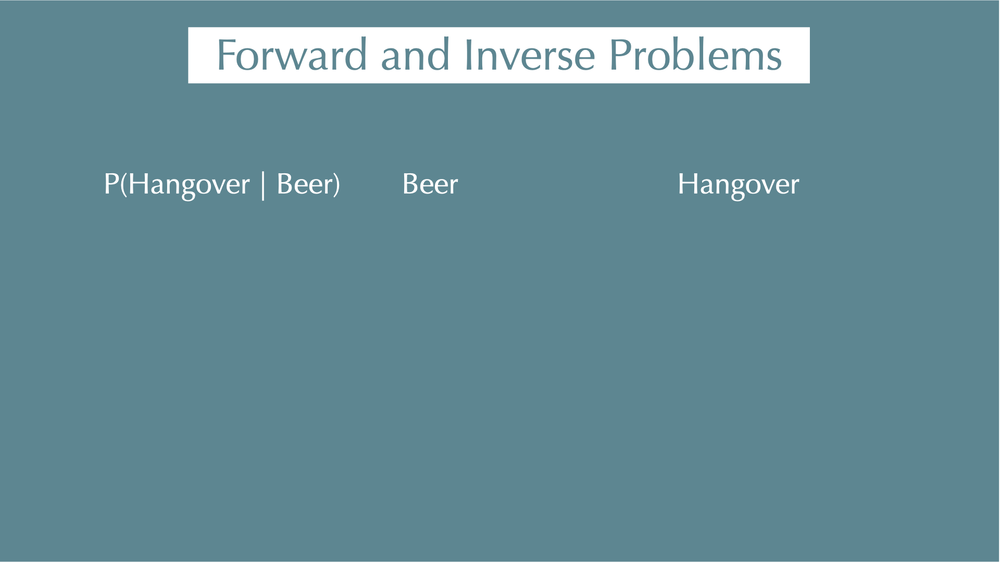

::: notes
- Read the first row from left to right: given beer, what is the chance of a hangover?
- This is the forward direction: start with a cause or parameter and predict an outcome or data.
- In a statistical model, the forward quantity is $P(\mathrm{Data} \mid \mathrm{Parameter})$.
:::

---

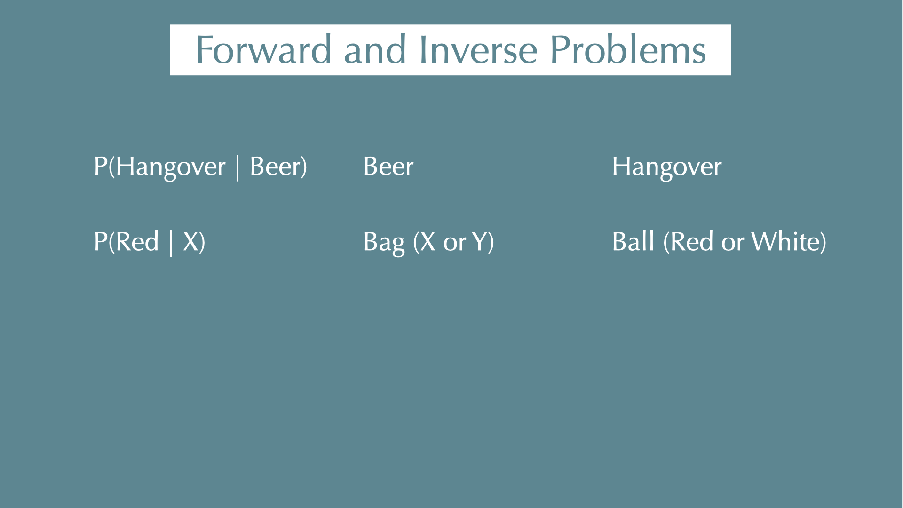

---

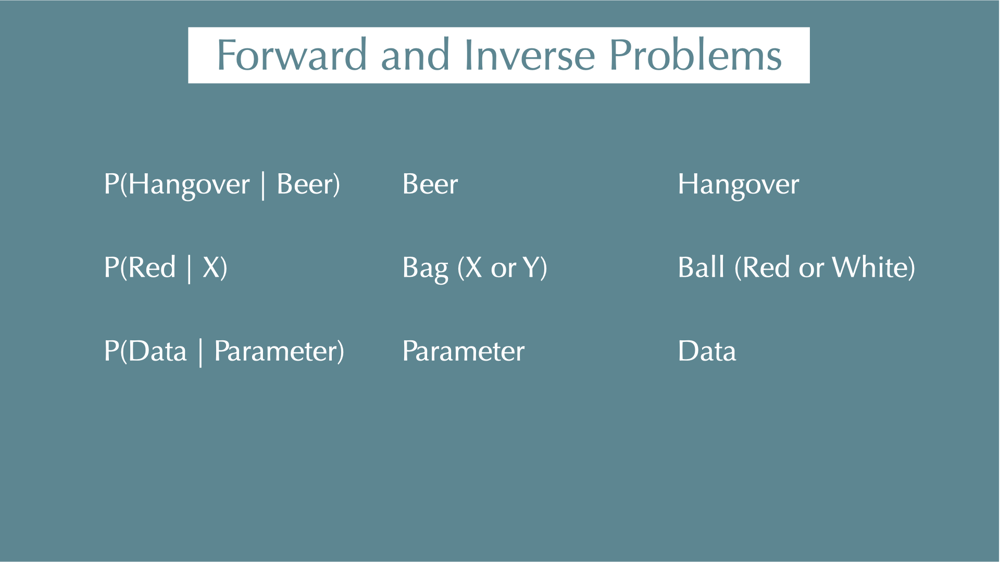

---

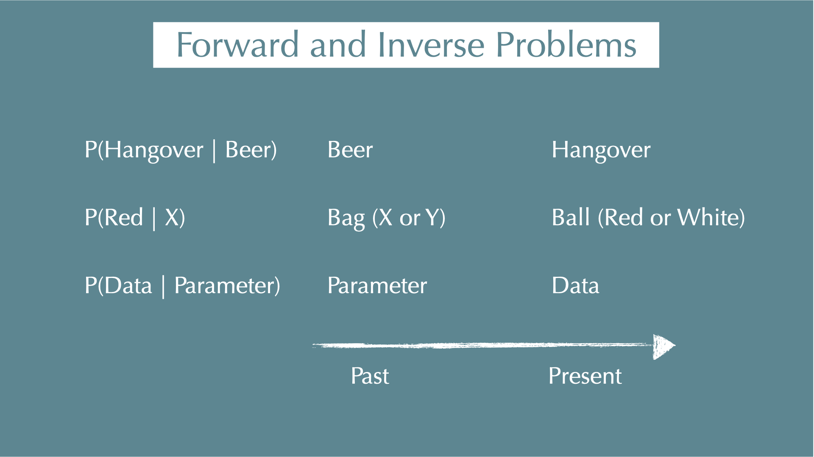

---

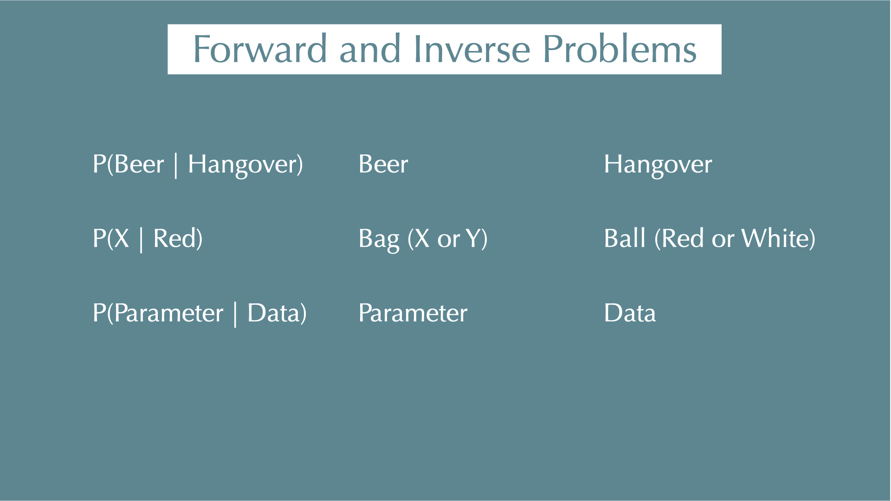

---

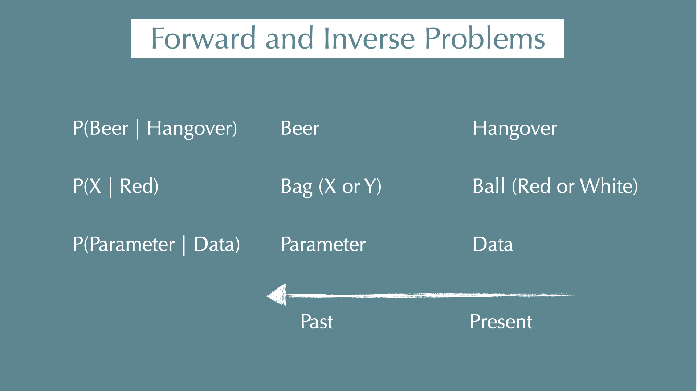

::: notes
- Now reverse the conditioning: given a hangover, what is the chance that beer was involved?
- This is the inverse direction: use observed data to learn about an unknown cause or parameter.
- Bayes' theorem relates this posterior to the forward probability and the prior.
:::

## Bayes' theorem

$$
\textcolor{#d95f02}{
  P(\mathrm{Parameter} \mid \mathrm{Data})
}
=
\frac{
\textcolor{#1b9e77} {
  P(\mathrm{Data} \mid \mathrm{Parameter})
} \times
\textcolor{#7570b3} {
  P(\mathrm{Parameter})}
}
{P(\mathrm{Data})}
$$

::: small
::: incremental
- $\textcolor{#d95f02}{P(\mathrm{Parameter} \mid \mathrm{Data})}$

  - **What we want to estimate ([posterior]{.orange})**: When we got our data, what were the parameters behind the data (e.g., survival probability, coefficients of regressions)?

- $\textcolor{#1b9e77}{P(\mathrm{Data} \mid \mathrm{Parameter})}$

  - When we know our parameters, what is the probability of getting our data? (i.e., **[likelihood]{.teal}**)

- $\textcolor{#7570b3}{P(\mathrm{Parameter})}$

  - What we assume about the parameter before we see the data (i.e., **[prior]{.purple}**).

- $P(\mathrm{Data})$

  - Does not depend on the parameters (i.e., a constant)
:::
:::

---

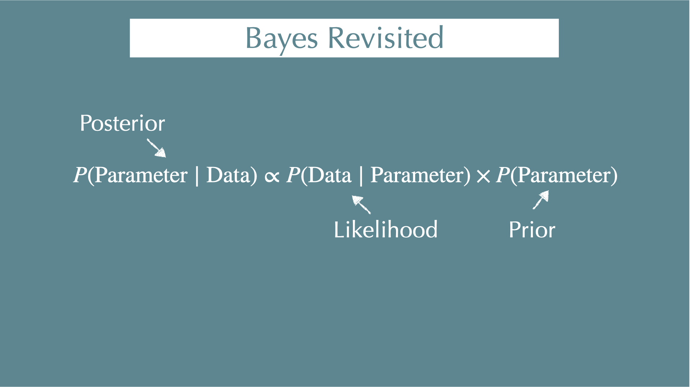

## Forward problem: a positive PCR test

::: footer
- $P(\text{Positive})$: 2%; $P(\text{Infected})$: 0.05%
:::

If a person is infected, what is the probability that the PCR test is positive?

::: incremental
- $P(\text{Positive} \mid \text{Infected}) = 95\%$
- This is the **forward problem**: given infection status, predict the test result.
:::

::: notes
- These are hypothetical teaching inputs, not current clinical performance estimates.
- Sensitivity is the probability of a positive result among infected people.
- For example, 95 of 100 infected samples may test positive.
:::

## Inverse problem: infection after a positive test

::: footer
- $P(\text{Positive})$: 2%; $P(\text{Infected})$: 0.05%
:::

If the PCR test is positive, how likely is it that the person is infected?

::: incremental
- Predict before revealing the calculation.
- $P(\text{Infected} \mid \text{Positive}) = \frac{P(\text{Positive} \mid \text{Infected})\,P(\text{Infected})}{P(\text{Positive})} \approx 2.4\%$
- This is the **inverse problem**: use the result to update what we believe about infection.
:::

::: notes
- 0.95 * 0.0005 / 0.02 = 0.02375
- The low prevalence matters: most people are not infected before testing.
- The calculation uses the specified 2% positive rate; it is not derived from sensitivity and prevalence here.
:::

# Prior and posterior

## Seedlings again: prior × likelihood = posterior

::: columns
::: {.column width="55%"}
```{r, fig.height=6, fig.width=8}
plot_update(2, 5, 1, 1, linewidth = 1.8) +
  ggtitle(NULL) +
  theme(legend.position = "top")
```
:::

::: {.column width="45%"}
::: small
- [Likelihood]{.teal}: 2 survivors out of 5, $y \sim \mathcal{B}(5, p)$
- [Prior]{.purple}: before the data, every $p$ between 0 and 1 is equally plausible, $p \sim \text{Beta}(1, 1)$
- [Posterior]{.orange}: $\propto p^2(1-p)^3 \times 1$

::: incremental
- The posterior describes uncertainty about $p$.
- Its mean is about `r round(3/7,2)`.
- A 90% interval runs from `r round(qbeta(.05,3,4),2)` to `r round(qbeta(.95,3,4),2)`.
- This interval depends on the model, prior and observed data.
:::
:::
:::
:::

::: notes
- Beta(1,1) prior + 2 of 5 -> Beta(3, 4) posterior
- contrast the interval statement with a confidence interval
- this small table (mean / interval / probability statement) is the reporting pattern for the whole course
:::

## Prior vs. Data: MLE and Bayesian comparison (Coin Toss)

As with seedling survival, the number of heads follows a Binomial model.
Keep the observed proportion at 0.6 and the prior fixed; change the number of tosses.

::: incremental

### MLE

- A: 3 heads out of 5 tosses → $\hat p_{\mathrm{MLE}} = 3/5 = 0.6$
- B: 60 heads out of 100 tosses → $\hat p_{\mathrm{MLE}} = 60/100 = 0.6$

::: columns
::: {.column width="50%"}
### Bayesian

- $\textcolor{#1b9e77}{L_A = \binom{5}{3} p^3 (1-p)^2}$
- $\textcolor{#1b9e77}{L_B = \binom{100}{60} p^{60} (1-p)^{40}}$
- $\textcolor{#7570b3}{\mathrm{Prior} \propto p^{50} (1-p)^{50}}$
  - Beta(51, 51): a **strong prior** concentrated near $p=0.5$.

:::

::: {.column width="50%"}
```{r, fig.height=4}
tibble(x = seq(0, 1, length = 200)) |>
  mutate(prior = dbeta(x, 51, 51)) |>
  ggplot(aes(x, prior)) +
  geom_line(linewidth = 1.5, colour = col_prior) +
  labs(x = "p", y = "Prior density") +
  theme(
    legend.position = "none",
    axis.text = element_text(size = 28),
    axis.title = element_text(size = 32))
```
:::

:::
:::

::: notes
- Allow 3–5 minutes for these two slides, including a prediction before revealing the updates.
- Ask: will each posterior peak be closer to 0.5 or to 0.6?
- The observed proportion and prior are identical, so the comparison isolates the amount of data.
- This deliberately strong prior illustrates its influence; it is not a default prior for ecological survival.
:::

## Bayesian updating: two amounts of coin data

```{r coin-posteriors, fig.width=11, fig.height=4.2}
p_grid <- seq(0,1,length.out=501)
coin <- tibble(p=p_grid, Prior=dbeta(p_grid,51,51),
               `3 of 5`=dbeta(p_grid,54,53), `60 of 100`=dbeta(p_grid,111,91)) |>
  pivot_longer(-p,names_to="Distribution",values_to="density")
ggplot(coin,aes(p,density,colour=Distribution,linetype=Distribution))+
  geom_line(linewidth=1.2)+labs(x="Probability of heads",y="Density")+
  theme(legend.position="top")
```

- Same observed proportion, same strong prior. More data change its influence.
- Posterior peaks (MAP): about 0.505 and 0.55. Both MLEs are 0.6.

::: notes
The posteriors are Beta(54,53) and Beta(111,91). MAPs are 53/105 and 110/200.
The means differ from the peaks. At 100 tosses the prior still has substantial
influence. These are deliberate teaching priors. Do not use them as defaults.
No derivation is required. Explain the figure before discussing the numbers.
:::

## Exercise: data and prior comparisons {background-color="#f3e8f5"}

`day1/exercise-student.qmd` · 12 minutes including explanation

- Predict, then compare 2/5 with 40/100 under the same flat prior.
- Keep the data at 2/5 and change the prior to Beta(8,2).
- Write one sentence for each comparison.

All code is supplied. Explain why a high-survival prior would or would not fit your habitat.

::: notes
58-70 minutes: 8 minutes of pair work and 4 minutes debrief.
Checkpoint at 4 minutes: both partners have predicted the sample-size comparison.
If R fails, use day1/results.html. This is the only required operation exercise.
:::

# From formulas to samples

## Stan and posterior samples

- We described the seedling posterior with a distribution.
- More complex models usually need numerical approximation.
- Stan produces draws that approximate the posterior.
- We read the distribution and check how the computation behaved.

::: notes
70-80 minutes is an instructor demonstration. No additional participant task.
The MCMC algorithms and HMC animation remain in the appendix.
:::

## A Stan model = data + parameters + model

::: columns
::: {.column width="50%"}
```{r, results="asis"}
show_stan("stan/binomial.stan", compact=TRUE)
```
:::

::: {.column width="50%"}
::: small
- `data`: what we observed, and the settings of the prior
  - $N = 5$, $y = 2$, $a = 1$, $b = 1$
- `parameters`: what we want to learn
  - $p$
- `model`: [prior]{.purple} and [likelihood]{.teal}
  - $p \sim \text{Beta}(a, b)$
  - $y \sim \mathcal{B}(N, p)$

::: fragment
Stan returns **draws** from the [posterior]{.orange} of every parameter.
:::

::: fragment
We pass the prior settings as data, so you can change the prior from R without touching the Stan file.
:::
:::
:::
:::

## The output is a table of draws

::: columns
::: {.column width="45%"}
```{r}
seedling_fit <- course_fit("day1_seedling")
```

```{r, echo=TRUE, eval=FALSE}
fit <- course_fit("day1_seedling")
fit$draws
```

```{r}
seedling_fit$draws |>
  as_tibble() |>
  select(.chain, .iteration, p) |>
  mutate(p = round(p, 3)) |>
  head(4) |>
  kable(format = "html") |>
  kable_material(c("striped"), full_width = FALSE, font_size = 24)
```

::: small
... `r ndraws(seedling_fit$draws)` rows
:::
:::

::: {.column width="55%"}
```{r, fig.height=4, fig.width=8}
ggplot(as_tibble(seedling_fit$draws), aes(p)) +
  geom_histogram(aes(y = after_stat(density)), bins = 40, fill = col_post, alpha = 0.5) +
  stat_function(fun = dbeta, args = list(3, 4), linewidth = 1.2) +
  labs(x = "Survival probability p", y = "Density",
    subtitle = "Stan draws and the exact Beta(3, 4) posterior")
```

::: small
::: incremental
- Posterior mean: `mean(draws$p)` = `r round(mean(seedling_fit$draws$p), 2)`
- 90% interval: `quantile(draws$p, c(0.05, 0.95))` = `r paste(round(quantile(seedling_fit$draws$p, c(0.05, 0.95)), 2), collapse = ", ")`
- $P(p > 0.5)$: `mean(draws$p > 0.5)` = `r round(mean(seedling_fit$draws$p > 0.5), 2)`
- Anything you can compute from $p$, you compute for every draw.
:::
:::
:::
:::

::: notes
- core: fit_or_load(..., use_precomputed = TRUE) reads the supplied Stan result
- optional live example uses the matching precompiled executable; no classroom compilation
- the summary numbers differ slightly from the exact ones: Monte Carlo error
:::

## A figure to explain to your partner

The same 2 survivors out of 5 can give different posterior distributions
under different priors.

- What does the likelihood contribute?
- What does the prior contribute?
- Which uncertainty would matter in your own research?

::: notes
80-85 minutes: short pair explanation followed by two contributions from the room.
Keep 85-90 minutes for questions and delay buffer.
:::

## Summary of Day 1

::: incremental
- **Likelihood**: how probable are the data for given parameter values.
- **Bayes' theorem** turns this around: [posterior]{.orange} $\propto$ [likelihood]{.teal} $\times$ [prior]{.purple}.
- The posterior is a **distribution**.
  We report means, intervals, and probabilities, not just the peak.
- The influence of a fixed prior depends on the information in the data.
- When there is no formula, **MCMC** gives draws from the posterior.
  We compute the quantities of interest from those draws.
:::

::: fragment
**Day 2**: does survival probability change with conspecific density?
We will read a fitted survival curve, make predictions and check the model.
:::

# Appendix: optional material {visibility="uncounted"}

## Four things that are easy to mix up {visibility="uncounted"}

::: small
| | What it is | Seedlings (2 of 5, prior Beta(8, 2)) |
|---|---|---|
| **MLE** | the $p$ that maximises the [likelihood]{.teal} | `r round(2/5, 3)` |
| **MAP** | the $p$ that maximises the [posterior]{.orange} (its peak) | `r round(9/13, 3)` |
| **Posterior mean** | the average of the [posterior]{.orange} | `r round(10/15, 3)` |
| **Posterior distribution** | every value of $p$ with its plausibility | Beta(10, 5) |
:::

::: incremental
- MLE and MAP are single numbers.
  They say nothing about uncertainty.
- With a flat prior, MAP = MLE.
  The posterior is still a distribution.
- In this course we work with the **whole posterior** and summarise it with a mean (or median) and an interval.
:::

## Which prior? Simulate from it {visibility="uncounted"}

```{r, fig.height=5.5, fig.width=15}
set.seed(1)
priors <- tribble(
  ~name, ~a, ~b,
  "Flat: Beta(1, 1)", 1, 1,
  "Weakly informative: Beta(2, 2)", 2, 2,
  "Informative: Beta(3, 7)", 3, 7
) |>
  mutate(name = fct_inorder(name))

dens <- priors |>
  mutate(d = map2(a, b, \(a, b) tibble(p = seq(0, 1, length.out = 201), density = dbeta(p, a, b)))) |>
  unnest(d)

sims <- priors |>
  mutate(s = map2(a, b, \(a, b) tibble(y = rbinom(1e4, 5, rbeta(1e4, a, b))))) |>
  unnest(s) |>
  count(name, y) |>
  group_by(name) |>
  mutate(prop = n / sum(n))

p1 <- ggplot(dens, aes(p, density)) +
  geom_line(linewidth = 1.5, colour = col_prior) +
  facet_wrap(~name) +
  scale_x_continuous(breaks = c(0, 0.5, 1)) +
  labs(x = "Survival probability p", y = "Prior density")

p2 <- ggplot(sims, aes(y, prop)) +
  geom_col(fill = col_prior, alpha = 0.7) +
  facet_wrap(~name) +
  labs(x = "Survivors out of 5 seedlings, simulated from the prior", y = "Proportion") +
  theme(strip.text = element_blank())

p1 / p2
```

::: small
::: incremental
- **Prior predictive check**: draw $p$ from the prior, simulate data, and ask "could data like these happen?"
- A prior is a statement about plausible *data*, so judge it on the scale of the data.
- In ecology we mostly use **weakly informative** priors: they put less prior weight on implausible parameter scales.
:::
:::

::: notes
- informative prior here: earlier censuses suggest about 30% of seedlings survive
- more on priors for regression coefficients on Day 2
:::


## Extension: deriving the binomial MLE {visibility="uncounted"}

- 2 survivors out of 5 seedlings: What is the survival probability of seedlings?

::: columns

::: {.column width=40%}

:::

::: {.column width=60%}
::: incremental
- $p$: survival probability; $1-p$: probability of dying

- $L = {}_5C_2 p^2(1-p)^3$ (Binomial distribution)

- $\mathrm{ln}\;L = \mathrm{ln}\;{}_5C_2 + 2\mathrm{ln}\;p + 3\mathrm{ln}(1-p)$

- $\frac{d}{dp}\mathrm{ln}\;L = \frac{2}{p} - \frac{3}{1-p} = 0$

- Solve: $p = \frac{2}{5}$

:::
:::
:::

## Extension: Normal density in R {visibility="uncounted"}

::: columns

::: {.column width=40%}

```{r, fig.height=7}
x <- seq(-5, 5, length.out = 100)
y <- dnorm(x, mean = 0, sd = 1)
tibble(x, y) |>
  ggplot() +
  xlab("x") +
  ylab("Density") +
  ggtitle("N(0, 1)") +
  geom_line(aes(x, y)) +
  theme(
    axis.title   = element_text(size = 32),
    axis.text    = element_text(size = 28))
```

::: small
$f(x \mid \mu, \sigma) = \frac{1}{\sqrt{2\pi\sigma^2}}\mathrm{exp} \bigl[{-\frac{1}{2}\bigl\{\frac{x-\mu}{\sigma}}\bigr\}^2\bigr]$
:::

:::
::: {.column width=60%}
::: incremental
- For continuous data, $f(\text{data}\mid\text{parameters})$ gives the **probability density** at the observed values.

- e.g., when your model is $x_i \sim \mathcal{N}(\mu = 0, \sigma = 1)$ (normal distribution with mean 0 and standard deviation 1), what is the probability density at x = 1.96?
:::

::: fragment
```{r, echo=TRUE}
dnorm(1.96, mean = 0, sd = 1)
```
:::

::: fragment
- A statistical model always has this form: a distribution for the data (normal, binomial, Poisson, ...) with unknown parameters.
:::

:::

:::

::: notes
- likelihood is all about probability density (mass) function (normal, log-normal, poisson, beta, gamma, binomial, negative-binomial...)
- NOTE: throughout the course N(mu, sigma) is written with the standard deviation, as in Stan and in dnorm()
:::


## Likelihood of several observations {visibility="uncounted"}

For independent observations $x=\{-1.5,\;0,\;1.5\}$, assume a Normal model with mean $\mu$ and standard deviation 1.
The likelihood is the joint probability density, viewed as a function of $\mu$.

::: small
::: incremental
- $L(\mu) = f(-1.5 \mid \mu, 1) \times f(0 \mid \mu, 1) \times f(1.5 \mid \mu, 1)$
- $\mathrm{ln}\;L(\mu) = \mathrm{ln}\;f(-1.5 \mid \mu, 1) + \mathrm{ln}\;f(0 \mid \mu, 1) +  \mathrm{ln}\;f(1.5 \mid \mu, 1)$
:::
:::

::: fragment

```{r, fig.height=3.5}
like_fun <- function(mu) {
  dnorm(-1.5, mean = mu, sd = 1, log = TRUE) +
    dnorm(0, mean = mu, sd = 1, log = TRUE) +
    dnorm(1.5, mean = mu, sd = 1, log = TRUE)
}

x <- seq(-5, 5, length.out = 100)
y <- like_fun(x)
tibble(x, y) |>
  ggplot() +
  xlab("mu") +
  ylab("ln L") +
  geom_line(aes(x, y)) +
  theme(
    axis.title   = element_text(size = 32),
    axis.text    = element_text(size = 28))
```
:::

::: fragment
The data are fixed.
The likelihood is a function of the **parameter**.
:::


---

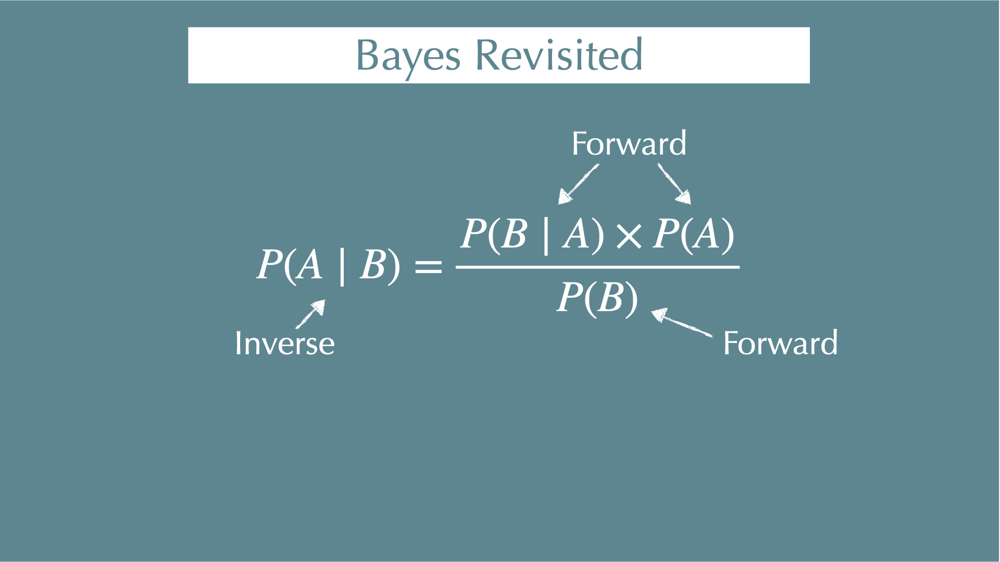

---


## MCMC: a simplified Metropolis-Hastings (MH) algorithm {visibility="uncounted"}

::: columns
::: {.column width="40%"}

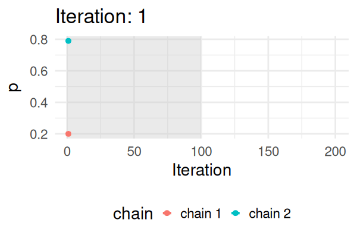{height=290}

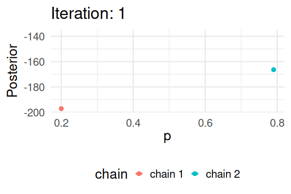{height=290}

:::

::: {.column width="60%"}

::: incremental
- Start with some values of *p* (e.g., 0.2 and 0.8).
- Calculate the posterior of those values.
- Repeat the following steps N times:
  - Propose a new value of $p_{\text{new}}$ (e.g., $p \pm 0.01$)
  - Calculate the posterior at $p_{\text{new}}$.
  - If $\text{Post}(p_{\text{new}}) \geq \text{Post}(p_t), \text{ then } p_{t+1} = p_{\text{new}}$.
  - Else, accept $p_{\text{new}}$ with probability $\frac{\text{Post}(p_{\text{new}})}{\text{Post}(p_t)}$.
- After the first steps (grey: **warmup**), the chain visits each value of $p$ in proportion to its posterior probability.
:::
:::
:::

::: notes
- example: coin B, posterior proportional to p^110 (1-p)^90
- two chains from different starting points end up in the same place: this idea returns on Day 2 as R-hat
:::


## MCMC: Hamiltonian Monte Carlo (HMC) {visibility="uncounted"}

::: columns

::: {.column width=40%}
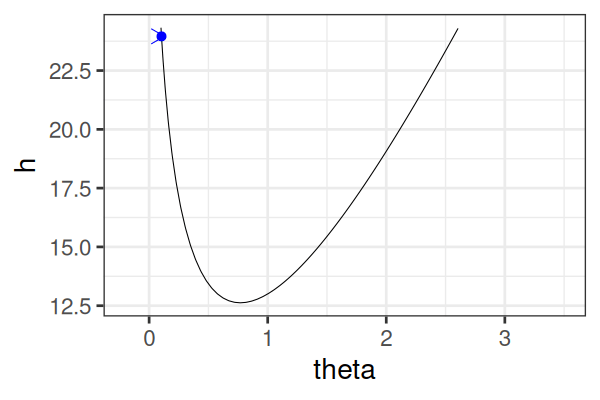

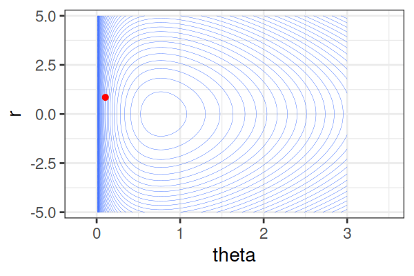
:::

::: {.column width=60%}

:::incremental

- $H(\theta, r) = U(\theta) + r^2/2$ (Hamiltonian: potential energy + kinetic energy = constant)

  - $U(\theta) = -\text{log}\; p(\theta \mid \text{data})$

- Instead of sampling from $p(\theta \mid \text{data})$, HMC samples from a joint distribution over both $\theta$ and $r$.

  - $p(\theta \mid \text{data}) \propto \int \text{exp}(-H(\theta, r))dr$

- It's equivalent to sampling from $p(\theta \mid \text{data}) \propto \text{exp}(-U(\theta))$.

- HMC explores very different $\theta$ along the same trajectory (i.e. leapfrog path), which is much more efficient than random sampling.

:::
:::
:::

## MCMC: Hamiltonian Monte Carlo (HMC) {visibility="uncounted"}

::: columns

::: {.column width=30%}
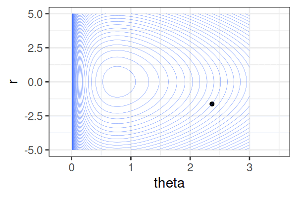

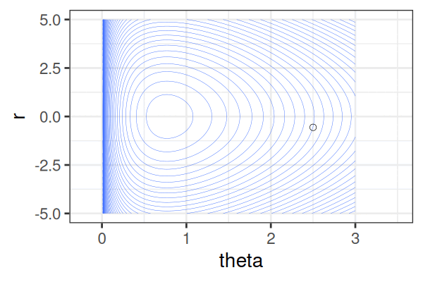

:::

::: {.column width=70%}

:::incremental

- Within each iteration, HMC simulates a trajectory using leapfrog steps.

    -  No-U-Turn Sampler (NUTS) adapts trajectory length. `max_treedepth` limits it; Stan also has other sampler settings.

- The Hamiltonian stays the same, but momentum $r$ is resampled each iteration.

- Only the final parameter $\theta$ of each trajectory is kept as a posterior sample.

:::
:::
:::

::: footer
The code behind these animations: `docs/hmc.qmd`, `R/hmc.R`
:::

## MCMC Methods: Comparison {visibility="uncounted"}

| Feature                    | **Metropolis(-Hastings)**          | **Gibbs Sampling**                        | **Hamiltonian Monte Carlo (HMC)**        |
|----------------------------|------------------------------------|-------------------------------------------|------------------------------------------|
| How it works               | Try random moves, accept/reject    | Update one parameter at a time            | Simulate smooth movement using gradients |
| Efficient in high dimensions? | ❌ Often slow                   | ✅ If math is simple                       | ✅ Very efficient                         |
| Flexible?                  | ✅ Yes                             | Depends on available conditional updates                   | ✅ Yes                                    |
| Typical software           | JAGS, custom R                     | JAGS, BUGS                                | Stan               |

## Interfaces to Stan (for R users) {visibility="uncounted"}

- Stan: The actual modeling and inference engine, written in C++.

- CmdStan: Command line interface (you write Stan code and run it via terminal).

- `rstan`, `cmdstanr`: R interface to Stan/Cmdstan (you write Stan code and run it within R).

- `brms`, `rstanarm`: Higher-level R packages that generate and run Stan models for you (you write an R formula, without writing Stan code).

- In this course, we use `cmdstanr` with models that are already written.
  `brms` versions of the same models are optional material on Days 2 and 3.

## References {visibility="uncounted"}

- [Gelman, A. et al. Bayesian Data Analysis, Third Edition. (Chapman & Hall/CRC, 2013)](http://www.stat.columbia.edu/~gelman/book/)

- [Stan User's Guide](https://mc-stan.org/docs/stan-users-guide/index.html)

- [Stan Functions Reference](https://mc-stan.org/docs/functions-reference/index.html)

- [AIcia Solid Project](https://youtu.be/mX_NpDD7wwg) (in Japanese and Math)
