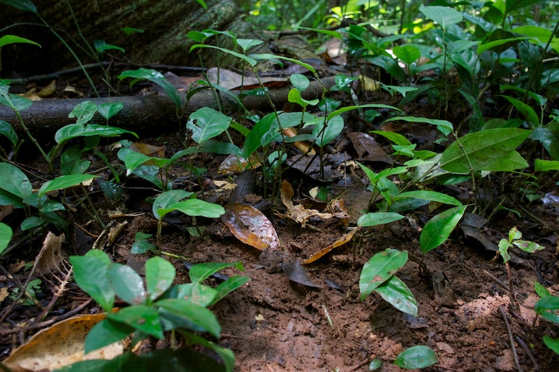

<!--
DAY 2 SESSION PLAN: 90 minutes. Agreed CNDD example.
Outcomes: read regression estimates and credible intervals; check sampling with
numerical diagnostics and traces; draw and interpret the survival curve.
Sampling diagnostics alone do not establish ecological model appropriateness.
Core: binomial regression, sampling checks, paired draws and survival curves,
the guided R walkthrough, and one existing PPC figure.
No R or GLM prerequisites. Core uses supplied draws/figures; code execution is optional. brms fitting is optional instructor reference.
Keep the MH idea and failed-chain contrast brief. Explain the R code and outputs
in the handout, then read the existing PPC figure without a code walkthrough or
additional exercise. Coefficient/diagnostic recaps, new-group count prediction,
predictive simulation details and new fitting remain optional reference.
If delayed, shorten the joint-posterior path discussion and species preview; Stan code is optional. Preserve the failed-chain contrast and interpretation of the regression outputs.
-->

```{r setup, include=FALSE}
source(here::here("R/slides_setup.R"))
ndd <- make_ndd_data()
fit <- course_fit("day2_ndd")
draws <- fit$draws
bad_fit <- course_fit("day2_allo_bad")
low <- plogis(draws$alpha - draws$beta)
high <- plogis(draws$alpha + draws$beta)
replicates <- cndd_replicates(draws, ndd, seed = 20261023)
```

##  {#title-slide background="../images/priors.png" background-size="50%" background-position="50% 20%"}

::: title-box
<h2>Bayesian statistics for ecology</h2>
<h3>Day 2: Linear regression and MCMC</h3>
<p>AFEC-X 2026 · 22 October</p>
<h3>Masatoshi Katabuchi @ XTBG, CAS</h3>
:::

## Yesterday's question, today's question

::: columns
::: {.column width="45%"}
{height=380}
:::
::: {.column width="55%"}

**Day 1:** what is the seedling survival probability?

**Day 2:** does that probability change with conspecific density?

We keep the binomial model and add a predictor.
:::
:::

## Today's objectives

**Understanding Bayesian regression**

- Read coefficient estimates and their credible intervals.
- Check sampling with numerical diagnostics and trace plots.
- Draw and interpret the fitted survival curve and its credible interval.

::: small
**Core:** regression results, sampling checks and one predictive-check figure.\
**Optional reference:** new fitting and further computational or predictive details.
:::

::: notes
Read completed models and results together. Coding is optional.
Use the handout for an instructor-led R walkthrough. Show code, output and
interpretation together. Participants can follow the rendered copy or run the
complete code alongside the explanation.
:::

## Conspecific negative density dependence

::: columns
::: {.column width="35%"}
{height=450}
:::
::: {.column width="65%"}

**CNDD:** in today's example, higher conspecific density goes with lower seedling survival.

Do species differ in this relationship?
Could those differences relate to species abundance?

Today we read one common survival curve. Tomorrow we consider group differences.
:::
:::

::: footer
Research motivation: [Comita et al. 2010, Science](https://doi.org/10.1126/science.1190772).
:::

::: notes
The research motivates the question. All numerical analyses today use simulated
teaching data, not the paper's observations or fitted results.
:::

## The data and a prediction

```{r observed-data, fig.width=11, fig.height=4.7}
ggplot(ndd, aes(cons, suv / n, size = n)) +
  geom_point(alpha = .7) +
  labs(
    x = "Conspecific density",
    y = "Observed survival\nproportion",
    size = "Seedlings"
  )
```

Which way would you expect the fitted curve to go?

::: notes
60 simulated quadrats. Point size represents the number of seedlings.
Distinguish an observed proportion from an unknown survival probability.
Pause for a prediction before showing a fitted curve.
:::

## The same binomial observation model

::: columns
::: {.column width="55%"}
$$s_i \sim \operatorname{Binomial}(n_i,p_i)$$

- $i$: a quadrat.
- $n_i$: number of seedlings of the focal species.
- $s_i$: number of survivors.
- $p_i$: survival probability in quadrat $i$.

Now let conspecific density $x_i$ predict $p_i$.

:::
::: {.column width="45%"}
{width=100% fig-alt="Seedlings growing among leaf litter on a forest floor in Panama."}
:::
:::

::: notes
The same count model as Day 1. Within a quadrat assume a common
probability and conditional independence. Missing shared conditions can violate
these assumptions. A single PPC figure follows the regression walkthrough.
:::

## A straight line and a probability curve

```{r link-function, fig.width=13, fig.height=4.2}
link_data <- tibble(x = seq(-3, 3, length.out = 101)) |>
  mutate(z = qlogis(.3) - .8 * x, p = plogis(z))
p1 <- ggplot(link_data, aes(x, z)) +
  geom_line(linewidth = 1.4, colour = col_like) +
  labs(x = "Conspecific density", y = "logit(p)")
p2 <- ggplot(link_data, aes(x, p)) +
  geom_line(linewidth = 1.4, colour = col_like) +
  ylim(0, 1) +
  labs(x = "Conspecific density", y = "Survival\nprobability")
p1 + p2
```

$$\operatorname{logit}(p_i)=\alpha+\beta x_i,\qquad
p_i=\operatorname{logit}^{-1}(\alpha+\beta x_i)$$

::: small
$$\operatorname{logit}(p)=\log\!\left(\frac{p}{1-p}\right),\qquad
\operatorname{logit}^{-1}(z)=\frac{1}{1+e^{-z}}$$
:::

::: notes
These are illustrative generating values, not posterior estimates.
The link keeps probabilities between zero and one. Explain the shapes and the
sign of the slope. No derivation, odds-ratio exercise or syntax memorisation.
Here log is the natural logarithm (0<p<1); z can be any real number.
The superscript -1 denotes the inverse function, not a reciprocal.
Source: Stan User's Guide, regression models.
:::


## Our model: seedling survival

<style>
#our-model-seedling-survival h2,
#what-are-we-estimating h2 { color: #222; }
#our-model-seedling-survival .model-columns { margin-top: 1.4em; }
#our-model-seedling-survival .model-equations { font-size: 1.2em; }
#our-model-seedling-survival .model-equations .math.display { margin: 0.8em 0; }
#our-model-seedling-survival .model-takeaway { margin-top: 1.5em; text-align: center; }
#what-are-we-estimating .inference-flow { margin: 0.8em auto 0; text-align: center; }
#what-are-we-estimating .inference-step { margin: 0.6em 0; }
#what-are-we-estimating .inference-step p { margin: 0.2em 0; }
#what-are-we-estimating .step-label { font-size: 0.75em; color: #333; }
#what-are-we-estimating .posterior-step { font-size: 1.2em; }
#what-are-we-estimating .model-takeaway { margin-top: 0.8em; text-align: center; }
</style>

::: {.columns .model-columns}
::: {.column width="42%"}
**Observed data**

- $n_i$: number of seedlings
- $s_i$: number of survivors
- $x_i$: conspecific density
:::
::: {.column width="58%"}
**Statistical model**

::: model-equations
$$s_i \sim \operatorname{Binomial}(n_i,p_i)$$

$$\operatorname{logit}(p_i)=\textcolor{#d95f02}{\alpha}+\textcolor{#d95f02}{\beta}\,x_i$$
:::

::: small
With the observed data fixed, this model defines the **likelihood** for $\alpha$ and $\beta$.
:::
:::
:::

::: model-takeaway
:::

::: notes
25-40 minutes: model recap, MCMC introduction, sampling checks and curve interpretation.
Focus on the observed/unknown distinction: n_i, s_i and x_i are observed in each
quadrat. The orange alpha and beta determine the survival curve. p_i is calculated
from those coefficients and x_i. The likelihood assumes common p and conditional
independence within each quadrat. Introduce the unknowns and priors on the next slide.
Connect to Day 1: hold the observed data fixed and compare coefficient pairs.
The binomial probabilities across quadrats, with p_i supplied by the logit
relation, define the likelihood as a function of alpha and beta. The link
equation alone is not the likelihood.
:::

## What are we estimating?

<style>
#what-are-we-estimating .unknown-parameters { margin: 0.6em 0 0; font-size: 1.05em; }
#what-are-we-estimating .updating-layout {
  display: grid;
  grid-template-columns: minmax(0, 1fr) 160px minmax(0, 1fr);
  align-items: center;
  min-height: 360px;
  margin: 0.5em 0;
}
#what-are-we-estimating .updating-panel {
  text-align: center;
  height: 300px;
  display: flex;
  flex-direction: column;
}
#what-are-we-estimating .updating-heading { font-size: 0.8em; font-weight: bold; color: #222; }
#what-are-we-estimating .updating-heading p { margin: 0 0 0.5em; }
#what-are-we-estimating .updating-body {
  min-height: 0;
  flex: 1;
  display: flex;
  flex-direction: column;
  justify-content: center;
  font-size: 1.12em;
}
#what-are-we-estimating .updating-body p { margin: 0.2em 0; }
#what-are-we-estimating .updating-body .katex-display { margin: 0.3em 0; }
#what-are-we-estimating .independent-note { font-size: 0.68em; }
#what-are-we-estimating .posterior-body { font-size: 1.3em; }
#what-are-we-estimating .data-arrow { text-align: center; color: #666; }
#what-are-we-estimating .data-arrow p { margin: 0; }
#what-are-we-estimating .data-label { font-size: 0.65em; }
#what-are-we-estimating .data-mechanism { font-size: 0.6em; line-height: 1.25; }
#what-are-we-estimating .arrow-symbol { font-size: 1.4em; line-height: 1; }
#what-are-we-estimating .posterior-takeaway { text-align: center; margin-top: 0.5em; }
</style>

::: unknown-parameters
**Unknown parameters:** $\textcolor{#d95f02}{\alpha,\beta}$
:::

::: updating-layout
::: updating-panel
::: updating-heading
Prior — Before seeing data
:::

::: updating-body
$$\textcolor{#d95f02}{\alpha}\sim\operatorname{Normal}(0,2.5)$$

$$\textcolor{#d95f02}{\beta}\sim\operatorname{Normal}(0,2.5)$$

::: independent-note
The priors are independent. The second argument is the SD.
:::
:::
:::

::: data-arrow
::: data-label
Data
:::

::: arrow-symbol
→
:::

::: data-mechanism
via the\
likelihood
:::
:::

::: updating-panel
::: updating-heading
Posterior — After seeing data
:::

::: {.updating-body .posterior-body}
$$p(\textcolor{#d95f02}{\alpha,\beta}\mid\mathrm{data})$$
:::
:::
:::

::: notes
Alpha and beta are the unknown coefficients. Alpha is log-odds at reference
density x=0; beta changes log-odds per one SD of density. Neither coefficient
is itself a probability or a percentage reduction.
Here Normal(0,2.5) uses the SD as its second argument, as throughout the course.
The two independent priors are unchanged and match stan/logit_reg.stan and the
stored fit, whose normal(0,2.5) syntax uses an SD. Do not square the Stan SD.
Read left to right: the priors describe uncertainty before seeing data; the
observed data update them to the joint posterior for alpha and beta. Data enter
the update through the likelihood from the preceding model slide. Independence
is a prior assumption, not a claim that the posterior coefficients are independent.
Day 1 calculated a posterior over a grid of p values; today we approximate the
posterior for pairs using simulated draws. Do not imply simulation finds true
parameters or that a grid is impossible for this two-parameter model.
After motivating the prior scales on the next slide, introduce the sampling idea.
:::

## Prior scales matter {#flat-prior-side-by-side}

::: columns
::: {.column width="55%"}
```{r flat-prior-survival-side-by-side, fig.width=8.8, fig.height=5.8, fig.alt="The same observed quadrat survival proportions and illustrative slopes as the earlier link-function example: a green gradual decline for beta=-0.8 and an orange dashed near-step for beta=-100. Point area represents seedling count."}
prior_density_grid <- seq(-3, 3, length.out = 2401)
slope_examples <- crossing(
  x = prior_density_grid,
  effect = factor(
    c("Previous example", "Extreme"),
    levels = c("Previous example", "Extreme")
  )
) |>
  mutate(
    beta = if_else(effect == "Previous example", -.8, -100),
    logit_p = qlogis(.3) + beta * x,
    p = plogis(logit_p)
  )
effect_colours <- c("Previous example" = col_like, "Extreme" = col_post)
effect_labels <- expression(
  paste("Previous example: ", beta == -0.8),
  paste("Extreme: ", beta == -100)
)
effect_labels_side <- expression(beta == -0.8, beta == -100)
ggplot(slope_examples, aes(x, p, colour = effect, linetype = effect)) +
  geom_vline(xintercept = 0, colour = "grey80", linewidth = .5) +
  geom_point(
    data = ndd,
    aes(cons, suv / n, size = n),
    inherit.aes = FALSE,
    shape = 21,
    fill = "grey60",
    colour = "grey30",
    alpha = .65,
    stroke = .4
  ) +
  geom_line(linewidth = 1.5) +
  scale_colour_manual(
    values = effect_colours,
    labels = effect_labels_side,
    name = NULL
  ) +
  scale_linetype_manual(
    values = c(1, 2),
    labels = effect_labels_side,
    name = NULL
  ) +
  scale_size_area(max_size = 6, breaks = c(5, 10, 20), name = "Seedlings") +
  scale_x_continuous(breaks = seq(-3, 3)) +
  scale_y_continuous(limits = c(0, 1), breaks = c(0, .25, .5, .75, 1)) +
  labs(x = "Conspecific density", y = "Survival\nprobability") +
  guides(
    colour = guide_legend(order = 1),
    linetype = guide_legend(order = 1),
    size = guide_legend(order = 2)
  ) +
  theme(
    legend.position = "bottom",
    legend.key.width = grid::unit(1.2, "cm"),
    legend.text = element_text(size = 18),
    legend.title = element_text(size = 18)
  )
```

::: small
**Points:** observed proportions.\
**Curves:** illustrative, not fitted.
:::
:::

::: {.column width="45%"}

::: small
$$
\begin{aligned}
\text{Very diffuse:}\quad &\beta\sim\mathcal N(0,10^4)\\[6pt]
\text{Weakly informative:}\quad &\beta\sim\mathcal N(0,2.5)
\end{aligned}
$$
:::

```{r slope-prior-relative-density, fig.width=6.8, fig.height=3.8, fig.alt="Zoomed comparison from beta=-120 to 20. Each prior density is divided by its own peak. The very diffuse Normal with SD 10000 is nearly flat across this range. The weakly informative Normal with SD 2.5 is concentrated near zero. An orange dashed line marks beta=-100, where the diffuse prior remains near its peak but the weakly informative density is negligible."}
prior_comparison <- crossing(
  beta = sort(unique(c(seq(-120, 20, length.out = 2801), -100, 0))),
  prior = factor(
    c("Very diffuse", "Weakly informative"),
    levels = c("Very diffuse", "Weakly informative")
  )
) |>
  mutate(
    prior_sd = if_else(prior == "Very diffuse", sqrt(1e8), 2.5),
    relative_density = exp(-.5 * (beta / prior_sd)^2)
  )
ggplot(
  prior_comparison,
  aes(beta, relative_density, colour = prior, linetype = prior)
) +
  geom_line(linewidth = 1.3) +
  geom_vline(
    xintercept = -100,
    colour = col_post,
    linetype = 2,
    linewidth = 1
  ) +
  annotate(
    "text",
    x = -100,
    y = .63,
    label = "beta == -100",
    parse = TRUE,
    colour = col_post,
    size = 6,
    hjust = -.12
  ) +
  geom_vline(xintercept = -.8, colour = col_like, linetype = 3, linewidth = 1) +
  annotate(
    "text",
    x = -.8,
    y = .35,
    label = "beta == -0.8",
    parse = TRUE,
    colour = col_like,
    size = 6,
    hjust = 1.12
  ) +
  scale_colour_manual(values = c("#006DAE", "#562457"), name = NULL) +
  scale_linetype_manual(values = c("dotted", "solid"), name = NULL) +
  scale_x_continuous(
    breaks = c(-100, -50, 0),
    expand = expansion(mult = c(.02, .03))
  ) +
  scale_y_continuous(limits = c(0, 1.04), breaks = c(0, .5, 1)) +
  labs(x = expression(beta), y = "Relative density") +
  theme(
    axis.title = element_text(size = 23),
    axis.text = element_text(size = 20),
    legend.position = "bottom",
    legend.text = element_text(size = 18),
    legend.key.width = grid::unit(.8, "cm")
  )
```

:::
:::

::: {.model-takeaway style="text-align: center; margin-top: 0.6em;"}
We use simulation to approximate the posterior.
:::

::: notes
The right figure compares prior shapes, before using observed outcomes.
Normal(0,10^4) means SD 10000 and variance 10^8.
Normal(0,2.5) means SD 2.5, matching the unchanged fitted-model slope prior.
The horizontal range [-120,20] is deliberately zoomed in: most of the diffuse
prior lies outside this window. These are relative densities f(beta)/f(0),
not probability densities that integrate to one over the shown range.
At beta=-100 the diffuse relative density is exp(-0.00005), about 0.99995;
the weak relative density is exp(-800), positive but below plotting precision.
Thus the diffuse prior gives equal-width neighbourhoods near -100 and 0 almost
the same prior weight; the weak prior greatly downweights -100. Do not compare
absolute density heights across priors from this peak-normalised plot.
The diffuse Normal is proper and is not literally a flat prior; it illustrates
locally almost flat weighting across the slopes being discussed. Keep that
separate from the binomial likelihood evidence in the left observations.

Allow about 2 minutes, following the model and prior/posterior recap. These are illustrative
curves, not fits. Keep alpha=logit(0.3), x in [-3,3] SD units, the binomial
observation model and the link fixed. The green curve is exactly slide 7's
alpha and beta. The dashed orange curve changes only beta to -100.
At x=0 both curves have p=0.3. Negative scaled density means below-average
density, not a negative number of neighbours. The large logit slope becomes
a near-step on the probability scale: the 99%-to-1% transition spans
(qlogis(.99)-qlogis(.01))/100 = 0.0919024 SD of density.
It is the abrupt transition across such a small density change that we judge
implausible for this teaching setting, not merely that p approaches 0 or 1.
Some ecological thresholds may be sharp; this is a contextual judgment, not a
universal prohibition on steep slopes or a conclusion estimated from these data.
Ask the before-data question first: would such an almost all-or-none change
across a tiny density difference be ecologically credible in this setting?
Then use the grey observations to show the additional evidence from the data.

The points reuse ndd=make_ndd_data() from the preceding data slide: all 60
simulated quadrats, with observed survival proportions suv/n. Point AREA is
proportional to n (5-20 seedlings); larger samples give more precise proportions
at a fixed underlying p. No jitter, filtering or new data were introduced.
Individual proportions fluctuate under the binomial model; points need not lie
on a probability curve. The two curves are not posterior estimates or fitted
alternatives. The green curve reuses the illustrative generating values; do not
claim its visual agreement is independent validation of the model.

For these observations the extreme curve also receives a much smaller binomial
likelihood: it predicts near-certain survival for many quadrats with deaths and
near-zero survival for many quadrats with survivors. These are count likelihoods,
not unweighted distances from the plotted proportions. The likelihood and prior
make distinct contributions. The observed mismatch is evidence from these data;
it is not the justification for choosing a prior after looking at the same data.
A flat prior leaves the likelihood to do the penalizing here. Weakly informative
priors can express the separate ecological judgment before observing outcomes,
which is especially useful when data are sparse. The preceding slide specifies
the full model's independent coefficient priors. Next explain how simulation
approximates the posterior.

Flat on beta means constant prior density: equal-width intervals around -0.8
and -100 receive the same weight, holding alpha fixed. It does not mean that
survival probabilities are uniform. Do not confuse density with a point
probability. A flat prior on the entire real line is improper, but that is not
the teaching argument here. Bounded flat priors can be proper, and flat priors
can be appropriate in some settings. The point is that flatness does not
automatically encode sensible predictions. Next ask how to retain uncertainty
while giving extreme effects less prior weight.
:::


## Approximate the posterior using simulation

MCMC generates a sequence of parameter values from the posterior distribution.

::: columns
::: {.column width="50%"}
{height=460 fig-alt="Two illustrative Metropolis chains updating a probability p over time."}
:::
::: {.column width="50%"}
{height=460 fig-alt="The same two chains moving on the log unnormalised target density."}
:::
:::

The sampled values describe uncertainty about the parameter.

::: notes
About two minutes. Begin with the purpose: we use simulation to obtain draws
that represent the posterior and its uncertainty. MCMC is the method used here
to generate those draws. MCMC means Markov chain Monte Carlo. Ask participants to follow
one coloured chain: a recorded step becomes one draw. A rejected proposal keeps
the current value, so repeated values must be counted too. The two starting
values are 0.2 and 0.8. Do not derive the acceptance probability or compare MCMC
algorithms here. With the symmetric proposals used in this illustration, moves
to higher target density are accepted; some moves to lower density are accepted
as well. This helps explore a distribution rather than only climbing to a peak.

These are the existing main.qmd teaching animations, generated by R/mh.R with
seed 123, 200 steps per chain and symmetric proposals of +/-0.01. Their target
is proportional to p^110 * (1-p)^90, corresponding to a Beta(111,91) density;
it is a separate probability illustration, not today's CNDD fit or Day 1's data.
The proposal grid gives a discrete approximation to that continuous target.
The right GIF's axis says 'Posterior', but its stored values are LOG unnormalised
density (110*log(p)+90*log(1-p)); explain this distinction orally.
It is not a histogram, a normalised posterior density or a plot of visit counts.
Explain that a histogram of many adequately explored retained values would
approximate the distribution. Neither this short animation nor overlapping
chains proves adequate exploration. The grey initial segment illustrates
initial movement; the actual CNDD plots that follow show post-warmup draws.

Transition: yesterday we represented uncertainty in one probability; today a
draw is a pair (alpha,beta). Stan uses HMC/NUTS, not this random-walk proposal.
The next slide shows actual saved CNDD pairs; then we check their exploration.
Source: https://mc-stan.org/docs/reference-manual/mcmc.html
:::

## MCMC samples multiple parameters jointly

::: columns
::: {.column width="45%"}
**One parameter:** save a value of $p$.

**Our logistic model:** save a pair $(\alpha,\beta)$.

:::
::: {.column width="55%"}
```{r posterior-exploration, fig.width=8, fig.height=4.1}
ndd_draw_table <- as_tibble(draws)
chain_excerpt <- ndd_draw_table |>
  filter(.chain == first(.chain)) |>
  slice_head(n = 25)
ggplot(ndd_draw_table, aes(alpha, beta)) +
  geom_point(colour = "grey65", alpha = .15, size = 1) +
  geom_path(data = chain_excerpt, colour = col_post, linewidth = .8) +
  geom_point(data = chain_excerpt, colour = col_post, size = 1.8) +
  labs(
    x = expression(alpha),
    y = expression(beta),
    subtitle = "Grey: saved pairs. Orange: part of one chain."
  )
```
:::
:::

Before interpreting these draws, did the simulation explore the posterior adequately?

::: notes
MCMC means Markov chain Monte Carlo. Stan uses an HMC-based MCMC sampler.
Each saved draw contains both coefficients: consecutive draws can be correlated.
The grey cloud is the actual stored joint posterior, not a schematic or new fit.
The orange path joins 25 consecutive post-warmup draws from one chain; it does not
show initialization or warmup and is not an optimization trajectory.
Ask why we might want several chains before moving to their traces.
This applies the preceding simulation idea to our actual regression; do not
restart the explanation of why MCMC is used. Each pair will later give one
survival curve, so the draws need to be reliable before making predictions.
No acceptance-rule or HMC derivation is required.
Source: https://mc-stan.org/docs/reference-manual/mcmc.html
:::

## Did the simulation explore the posterior?

Compare several chains before using the draws for survival predictions.

```{r trace, fig.width=12, fig.height=3.9}
trace_slide_theme <- theme(
  axis.title = element_text(size = 26),
  axis.text = element_text(size = 24),
  strip.text = element_text(size = 26),
  legend.title = element_text(size = 24),
  legend.text = element_text(size = 24),
  legend.position = "bottom"
)
trace_slide_colours <- scale_colour_viridis_d(option = "D", end = .85)
bayesplot::mcmc_trace(draws, pars = c("alpha", "beta")) +
  trace_slide_colours +
  trace_slide_theme
```

- Are the chains mixing well?

::: notes
First identify the horizontal axis (saved sampling step), vertical axis (coefficient
value), and colours (chains). These are the actual post-warmup stored draws.
Look for persistent drift or between-chain offsets, rather than interpreting any
single jump. Overlap is encouraging but does not establish convergence by itself.
The instructor also checks numerical diagnostics; overlap alone is insufficient.
The diagnostic comparison is in Optional reference for later questions.
Transition orally: more complex models or problems in model formulation can
make sampling difficult. Show a separate teaching failure as a short caution;
it does not replace the CNDD fit and is not a test of ecological correctness.
Source: https://mc-stan.org/learn-stan/diagnostics-warnings.html
:::

## What does failed exploration look like?

::: small
More complex models or problems in model formulation can make posterior sampling difficult.
:::

```{r failed-trace, fig.width=12, fig.height=3.9}
bayesplot::mcmc_trace(bad_fit$draws, pars = c("alpha1", "alpha2")) +
  trace_slide_colours +
  trace_slide_theme +
  facet_wrap(
    ~parameter,
    nrow = 1,
    scales = "free_y",
    labeller = as_labeller(c(alpha1 = "Parameter 1", alpha2 = "Parameter 2"))
  )
```

Here, the chains remain in different regions.

We should investigate before interpreting these draws.

::: notes
Spend about one minute comparing this with the preceding CNDD traces. These are
actual post-warmup draws from fits/day2_allo_bad.rds, not altered CNDD draws or a
schematic. Do not use this fit for ecological interpretation.
The response is log(height); x is log(DBH / reference DBH). Unlike the binomial
CNDD model, this is a Normal regression. Both models use MCMC for coefficients,
so the same question applies: have the chains explored the posterior adequately?
Here the deliberately redundant intercepts, each with a Normal(0,1000) prior
(SD 1000), create a difficult long ridge. The data inform their sum, not the two
intercepts separately. Proper priors make the posterior proper, but these very
broad priors do not make this run reliable. Keep this explanation oral and brief:
"This is a separate teaching example with duplicated intercepts, not today's
CNDD result." Do not introduce its equation or derive the cause here.
A complex model can be scientifically appropriate and still be hard to sample;
a scientifically inappropriate model can sample well. Neither complexity nor
model error guarantees this trace pattern. The plotted failure is evidence
from this particular stored run, not an inevitable outcome of two intercepts.
Details of this model and remedies are in Optional reference, together with
numerical diagnostics. Return directly to the original CNDD fit on the next
slide: its paired coefficient draws each give one survival curve.
Source: https://mc-stan.org/docs/stan-users-guide/problematic-posteriors.html
:::

## 10 posterior draws, 10 survival curves

$$p(x)=\operatorname{logit}^{-1}(\alpha+\beta x)$$

```{r curve-pairs-setup, include=FALSE}
# Show the first ten saved paired draws; the table continues beyond this excerpt.
curve_pairs <- as_tibble(draws) |>
  slice_head(n = 10) |>
  select(alpha, beta) |>
  mutate(Draw = 1:10, .before = 1)
curve_examples <- curve_pairs |>
  crossing(density = seq(min(ndd$cons), max(ndd$cons), length.out = 101)) |>
  mutate(p = plogis(alpha + beta * density))
```

::: columns
::: {.column width="30%"}
```{r curve-pairs-table}
curve_pairs |>
  mutate(
    across(c(alpha, beta), ~ sprintf("%.3f", .x)),
    Draw = as.character(Draw)
  ) |>
  bind_rows(tibble(Draw = "⋮", alpha = "⋮", beta = "⋮")) |>
  knitr::kable(format = "html", col.names = c("Draw", "α", "β")) |>
  kableExtra::kable_styling(font_size = 20, full_width = FALSE) |>
  kableExtra::row_spec(0:11, extra_css = "padding: 4px 8px;")
```
:::
::: {.column width="70%"}
```{r paired-curves, fig.width=8, fig.height=3.9}
ggplot(curve_examples, aes(density, p, group = Draw)) +
  geom_line(linewidth = 1.2, colour = "grey40") +
  scale_y_continuous(limits = c(0, 1)) +
  labs(x = "Conspecific density", y = "Survival\nprobability")
```
:::
:::

Ten possible curves for the **same survival relationship**.

::: notes
Each table row supplies both coefficients for one curve. The displayed
coefficients are rounded, but curves use their full precision. Rows are the first
ten saved paired draws, not independently chosen alpha and beta values. The
vertical ellipses indicate that the stored draw table continues; they are display
labels, not extra draws. These ten rows need not span the posterior range.
All curves use the
same grey: these are alternative draws for the same relationship. The later
species preview uses different colours for different species.
The next slide shows 1000 draws before summarising ALL stored draws as a ribbon.
These ten illustrative draws do not define the ribbon.
:::

## 1000 posterior draws, 1000 survival curves

```{r many-survival-curves, fig.width=12, fig.height=4.3}
set.seed(20261024)
curve_sample <- as_tibble(draws) |>
  slice_sample(n = 1000) |>
  select(.draw, alpha, beta) |>
  crossing(density = seq(min(ndd$cons), max(ndd$cons), length.out = 101)) |>
  mutate(p = plogis(alpha + beta * density))
ggplot(curve_sample, aes(density, p, group = .draw)) +
  geom_line(colour = "grey40", alpha = .04, linewidth = .5) +
  scale_y_continuous(limits = c(0, 1)) +
  labs(x = "Conspecific density", y = "Survival\nprobability")
```

Each curve comes from one posterior draw.

::: notes
These are 1000 randomly selected actual paired draws without replacement from the
same stored posterior, with a fixed seed. Each pair supplies a whole curve for the
same survival relationship. Grey lines show uncertainty, not species differences
or simulated survivor counts. Keep the density range and probability limits the
same as the ten-curve figure. At any fixed density, the spread of curves shows
uncertainty about p. The next slide uses ALL stored draws to calculate pointwise
2.5th/97.5th percentiles and the median; the visible 1000-curve envelope is not that interval.
:::

## All draws give a ribbon of survival curves

```{r fitted-curve, fig.width=12, fig.height=4.3}
plot_cndd(draws, ndd) +
  labs(x = "Conspecific density") +
  labs(
    y = "Survival\nprobability",
    subtitle = "Line: posterior median. Ribbon: 95% credible interval for survival probability."
  )
```

Each point represents one quadrat.

The ribbon shows uncertainty about **survival probability** at each density.

::: notes
At each x, transform every paired draw into p, then calculate the median and
2.5th/97.5th percentiles. The line is not MLE or MAP and need not equal a single drawn
curve. The ribbon contains pointwise 95% credible intervals, not a simultaneous
band for the whole function.
The observed proportions include binomial variation, so this is not an interval
that must contain the observations. Participants will construct the same kind of
curve from the paired draws using plogis(), quantile() and ggplot() in the exercise.
:::

## Stan: A modern language/software for Bayesian modeling

<style>
#stan-a-modern-languagesoftware-for-bayesian-modeling pre code {
  font-size: 0.8em;
  line-height: 1.2;
}
</style>

::: columns

::: {.column width=35%}


```{stan, output.var="bernoulli", file=here::here("stan/bernoulli.stan"), eval=FALSE, echo=TRUE}
```


:::

::: {.column width=65%}

::: incremental

- 🧑🏻‍💻 **Bayesian Modeling**

  - Stan uses the No-U-Turn sampler (NUTS), a variant of Hamiltonian Monte Carlo (HMC), which is efficient for complex models with many parameters.

- ⚙️ **Flexible and Scalable**

  - You can use Stan for many types of models, from simple regressions to multi-level models including time-series, spatial, SEM, and more.

- 💻 **Multiplatform**

  - Stan works with R, Python, Julia, and more.
  It also has tools for checking models and making visualizations.

:::
:::
:::

::: notes
Brief introduction (about 1 minute); no compilation or live sampling.
The small Stan example records each seedling as a 0/1 outcome, with a common
survival probability theta. Summing those independent Bernoulli outcomes gives
the binomial count model from Day 1. Today's regression extends the survival
probability to depend on density. Do not walk through every code line here.
:::

## {#stan-from-r background-image="../images/cmdstanr_brms.png" background-size="contain" background-color="white"}

::: notes
Brief interface comparison (about 1 minute). cmdstanr uses handwritten Stan;
brms generates Stan code from an R model specification. Both use Stan for sampling.
The diagram's brm(y ~ x) is schematic; our binomial survival model also needs
survivor/trial counts, the binomial family and priors. Use the supplied handout
for the actual course model, not the schematic call as executable course code.
If short of time, state the interface distinction briefly and continue to the
walkthrough. No participant installation or new inference is required.
:::

## R walkthrough: survival regression {background-color="#f3e8f5"}

`day2/exercise-student.qmd`

We follow the R code and its outputs:

1. Coefficient summaries and credible intervals.
2. Sampling diagnostics.
3. Trace plots.
4. Survival probabilities and a regression plot.

Offline outputs: `day2/results.html`.

::: notes
Guide the class through the handout, showing code and output together. Follow
the root exercise.qmd style: explain the table columns and actual results,
then the diagnostics, traces and graph. No timed student tasks, separate
questions, written responses or debrief cycle. Running code alongside the
instructor is optional; the rendered copy and result sheet contain the outputs.
Keep read_csv(), readRDS(), summarise_draws(), mcmc_trace(), plogis(), quantile()
and ggplot() visible rather than hiding analysis in course-specific helpers.
Return to the single PPC figure after the walkthrough. Repeated table slides and
predictive simulation details remain optional. Keep time for questions.
:::

## Does the density pattern look compatible?

```{r check-pattern, fig.width=12, fig.height=3.9}
plot_cndd_check(replicates, ndd) +
  labs(x = "Conspecific density") +
  labs(
    y = "Survival\nproportion",
    subtitle = "Open: observed. Orange: 95% predictive intervals."
  )
```

Compare observed proportions with replicated data at the same density and seedling count.

::: notes
A brief figure-reading example after the regression walkthrough. Use the existing
figure without an additional exercise or a predictive-code demonstration.
The intervals concern replicated proportions at observed n_i, not uncertainty
about p_i alone. Binomial variation is included. Inspect the density pattern and
variation; an occasional point outside an interval is not by itself a failure.
These are simulated teaching data. Similar patterns do not prove the model
correct, and this check is separate from MCMC diagnostics.
:::

## Tomorrow: species may differ

```{r species-preview, fig.width=10, fig.height=4.1}
plot_cndd_species() + labs(x = "Conspecific density")
```

Some species have few seedlings. How can we estimate their relationships?

::: notes
A brief Day 3 preview only: conceptual simulation, not a species-level fit of
today's data. Do not explain hierarchical equations or add an exercise now.
Day 3 introduces sharing through mother trees first; omit this preview if delayed.
:::

## References

- [Comita et al. 2010, Science](https://doi.org/10.1126/science.1190772)
- [Song & Katabuchi et al. 2024, Ecology](https://doi.org/10.1002/ecy.4382)
- [Stan Reference Manual: MCMC](https://mc-stan.org/docs/reference-manual/mcmc.html)
- [Stan: diagnostics and warnings](https://mc-stan.org/learn-stan/diagnostics-warnings.html)
- [Stan User's Guide: problematic posteriors](https://mc-stan.org/docs/stan-users-guide/problematic-posteriors.html)
- [Stan User's Guide: regression](https://mc-stan.org/docs/stan-users-guide/regression.html)
- [Stan User's Guide: predictive checks](https://mc-stan.org/docs/stan-users-guide/posterior-predictive-checks.html)
