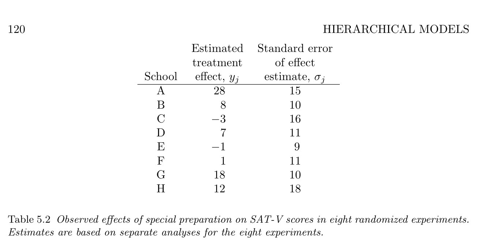

<!--
DAY 3 SESSION PLAN (90 min) -- Hierarchical models and ecological applications

Learning outcomes: by the end of the session participants can
  1. explain complete pooling, no pooling and partial pooling, and predict
     which groups change most under partial pooling;
  2. interpret a group-level standard deviation and a group-level predictor;
  3. predict for an existing group and for a new group;
  4. read the diagnostics of a hierarchical model (including divergences);
  5. outline a workflow for their own grouped ecological data.

Timing
   0- 5  Recap, today's question: grouped data
   5-25  Eight mother trees: complete / no / partial pooling
  25-45  Exercise 3A (live: three ways to estimate eight survival rates)
  45-60  Multilevel regression: varying intercepts, varying slopes,
         group-level predictor, diagnostics
  60-80  Exercise 3B (stored results by default: species differences in allometry)
  80-90  Why Bayes for multilevel models, workflow, looking ahead, summary

If time runs short: skip "Same model, different tools" and "Divergent
transitions" (keep one sentence), and do Exercise 3B part 2 as a demonstration.
The eight schools and spatial slides are in the appendix.
-->

```{r setup, include=FALSE}
source(here::here("R/slides_setup.R"))

trees <- make_tree_data()
trees_fit <- read_fit("day3_trees")
allo <- make_allometry_data()
vint_fit <- read_fit("day3_vint")
vslope_fit <- read_fit("day3_vslope")
dbh_ref <- allometry_truth$dbh_ref

# posterior summaries used on several slides
p_sum <- trees_fit$draws |>
  subset_draws(variable = "p") |>
  summarise_draws(mean, median, ~quantile(.x, c(0.05, 0.95)))
trees_re <- trees |>
  mutate(p_bayes = p_sum$median, p_lo = p_sum$`5%`, p_hi = p_sum$`95%`)
suv_pool <- sum(trees$suv) / sum(trees$n)

rmse <- function(est) sqrt(mean((est - trees$p_true)^2))
```

##  {#title-slide background="../images/priors.png" background-size="50%" background-position="50% 20%"}

::: title-box
<h2>Bayesian statistics for ecology</h2>

<h3>Day 3: Hierarchical models and ecological applications</h3>

<h3>🧑🏻‍💻 [Masatoshi Katabuchi \@ XTBG, CAS]{.author}</h3>
:::

## So far, and today

::: columns
::: {.column width="50%"}
### Day 1 and Day 2

- [Posterior]{.orange} $\propto$ [likelihood]{.teal} $\times$ [prior]{.purple}
- Regression, prediction, model checking
- Yesterday's last check: one line for all trees does not fit every **species**
:::

::: {.column width="50%"}
### Today

By the end of today, you can

::: incremental
- explain **complete pooling**, **no pooling**, and **partial pooling**;
- interpret variation **among groups**;
- predict for a known group and for a **new group**;
- plan a Bayesian workflow for your own grouped data.
:::
:::
:::

::: fragment
Ecological data are grouped: seedlings within mother trees, trees within species, quadrats within plots, censuses within years.
:::

# Partial pooling

## Eight mother trees problem

What is the survival rate?

::: columns
::: {.column width="30%"}
```{r}
trees |>
  dplyr::select(tree:suv) |>
  knitr::kable(format = "html") |>
  kable_material(c("striped", "hover"), full_width = FALSE)
```
:::

::: {.column width="70%"}

We followed the seedlings under eight mother trees of one species.

::: incremental

- suv $\sim$ B(n, p) (Binomial distribution)

- p  = suv / n (Maximum likelihood estimation: MLE)

:::

::: fragment
```{r, echo = TRUE}
sum(trees$suv) / sum(trees$n)
```

:::

::: incremental

- If we pool all the data, the survival rate will be about `r suv_pool |> round(3)`

:::

:::

:::

::: footer
The ecological cousin of the "eight schools" problem (Rubin 1981; Gelman et al. 2013). See the appendix.
:::

## Eight mother trees problem (separate estimates)

::: columns
::: {.column width="40%"}
```{r}
trees |>
  knitr::kable(format = "html") |>
  kable_material(c("striped", "hover"), full_width = FALSE, font_size = 24)
```
:::

::: {.column width="60%"}

::: incremental
::: small
- If we estimate each tree separately, survival rates will be `p_like`
- `p_true` ranges [`r min(trees$p_true)`, `r max(trees$p_true)`]

- `p_like` ranges [`r min(trees$p_like)`, `r max(trees$p_like)`]
- The estimates vary more than the truth

- Because of the small sample size (common in ecological studies)
:::
:::

::: fragment
```{r, fig.height=3.6, fig.width=8, out.width="75%"}
ggplot(trees, aes(x = p_true, y = p_like)) +
  geom_point(size = 8, pch = 21) +
  geom_abline(slope = 1, intercept = 0, lty = 2) +
  annotate(geom = "text", x = 0.34, y = 0.38, label = "1:1", size = 10, angle = 18) +
  xlab("True survival rate") +
  ylab("Estimated \nsurvival rate")
```
:::

:::

:::

::: notes
- These data were simulated based on `p_true`, but the ML estimates are slightly different
- we want to improve the estimates
:::

::: footer
We know `p_true` because we generated this data using `p_true` as a known parameter. In practical scenarios, we don't know `p_true`.
:::

## Extreme case 1: Pooled estimates

::: columns
::: column
- $S_i \sim \mathcal{B}(N_i, p)$: Likelihood
- $\mathrm{logit}(p) \sim \mathcal{N}(0, 2.5)$: Prior


:::

::: column
::: incremental
- This model assumes all mother trees share the exact same survival rate.
- **Complete pooling**: 8 trees, 1 parameter.
- It cannot answer any question about differences among trees.
:::
:::
:::

## Extreme case 2: Separate estimates

::: columns
::: column

- $S_i \sim \mathcal{B}(N_i, p_i)$: Likelihood
- $\mathrm{logit}(p_i) \sim \mathcal{N}(0, 2.5)$: Prior


:::

::: column
::: incremental
- This model assumes each mother tree has a completely independent survival rate.
- **No pooling**: what we learn from tree A tells us nothing about tree B.
- With limited data per tree, this model tends to overfit and produces noisy estimates.
- We need to find a balance between these two extremes.
:::

:::
:::

::: notes
- if we have infinite amount of data, we can estimate survival rates separately
- usually, we don't have enough data (model tends to overfit)
- We need to find a balance between these two extremes
:::

## Multilevel models: partial pooling

- $S_i \sim \mathcal{B}(N_i, p_i)$: Likelihood

- $\mathrm{logit}(p_i) \sim \mathcal{N}(\mu, \sigma)$: Group-level model (hierarchical prior)

- $\mu \sim \mathcal{N}(0, 5)$: Hyperprior

- $\sigma \sim \text{Half-}\mathcal{N}(0, 1)$: Hyperprior


::: fragment
The prior for each tree is no longer fixed by us. Its mean $\mu$ and spread $\sigma$ are **estimated from all trees**.
:::

::: notes
- these are the priors in stan/logistic.stan
- complete pooling is the special case sigma = 0; no pooling is sigma = infinity
:::

## $\sigma$ determines group-level variation

The overall survival rate is 0.5 in this figure.
We have some sense of a scale for $\sigma$.

::: columns
::: {.column width=50%}
```{r, fig.height=8.5}
set.seed(123)
z <- 0
sig1 <- 0.1
sig2 <- 1
sig3 <- 3
n_sp <- 8
sig <- 0.2

xx <- seq(-3, 3, length = 100)
mu1 <- rnorm(n_sp, z, sig1)
mu2 <- rnorm(n_sp, z, sig2)
mu3 <- rnorm(n_sp, z, sig3)

data <- tibble(mu1 = as.list(mu1), mu2 = as.list(mu2), mu3 = as.list(mu3), sp = LETTERS[1:8]) |>
  mutate(y1 = map(mu1, \(mu)dnorm(xx, mu, sig))) |>
  mutate(y2 = map(mu2, \(mu)dnorm(xx, mu, sig))) |>
  mutate(y3 = map(mu3, \(mu)dnorm(xx, mu, sig))) |>
  unnest(cols = c(mu1, mu2, mu3, y1, y2, y3))  |>
  mutate(xx = rep(xx, 8))

plot_density <- function(data, y, title_suffix) {
  ggplot(data, aes(x = logistic(xx), y = {{y}}, col = sp)) +
    geom_line() +
    xlab("p") +
    ylab("Density") +
    theme(legend.position = "none") +
    ggtitle(paste("sigma =", title_suffix))
}

p1 <- plot_density(data, y1, "0.1")
p2 <- plot_density(data, y2, "1")
p3 <- plot_density(data, y3, "3")

p1 / p2 / p3
```
:::

::: {.column width=50%}
::: fragment
```{r, fig.height=8.5}
plot_sigma <- function(density_func, params, title) {
  y <- density_func(sigma, params[[1]], params[[2]])
  tibble(sigma, y) %>%
    ggplot(aes(x = sigma, y = y)) +
    geom_line() +
    xlab("Sigma") +
    ylab("Density") +
    ggtitle(title)
}

# Sigma values
sigma <- seq(0.01, 10, length = 100)

# Generating plots
p4 <- plot_sigma(dcauchy, list(0, 1), "sigma ~ Half-Cauchy(0, 1)")
p5 <- plot_sigma(dnorm, list(0, 1), "sigma ~ Half-N(0, 1)")
p6 <- plot_sigma(dnorm, list(0, 10), "sigma ~ Half-N(0, 10)")

p4 / p5 / p6
```
:::
:::
:::

::: notes
- on the logit scale
- we have some sense of a scale for sigma
- sigma = 0.3 -> +/- 7%
- sigma = 3 -> +/- 45%
- sigma = 10 -> +/- 49.99%
- left: each curve is one tree; right: candidate priors for sigma. Half-N(0, 10) puts most weight on absurdly large variation
:::

## Better estimates via partial pooling

::: columns
::: {.column width="40%"}

```{r}
trees_re |>
  dplyr::select(tree, n, suv, p_like, p_true, p_bayes) |>
  mutate(p_bayes = round(p_bayes, 2)) |>
  knitr::kable(format = "html") |>
  kable_material(c("striped", "hover"), full_width = FALSE, font_size = 26)
```
:::

::: {.column width="60%"}

```{r, fig.height=4}
trees_re |>
  pivot_longer(c(p_like, p_bayes)) |>
  ggplot(aes(x = p_true, y = value, fill = name)) +
    geom_point(size = 12, pch = 21, alpha = 0.8) +
    annotate(geom = "text", x = 0.34, y = 0.38, label = "1:1", size = 10, angle = 18) +
    geom_abline(slope = 1, intercept = 0, lty = 2) +
    xlab("True survival rate") +
    ylab("Estimated \nsurvival rate") +
    theme(
      legend.position = "inside",
      legend.position.inside = c(0.2, 0.75),
      legend.text = element_text(size = 24),
      legend.title = element_blank(),
      legend.box.background = element_rect(color = "grey40", linewidth = 1)
    )
```

::: small
::: incremental
- `p_bayes`{.small} (posterior median) is closer to the 1:1 line: average error `r round(rmse(trees_re$p_bayes), 3)`, against `r round(rmse(trees$p_like), 3)` for `p_like`{.small}.

- The model compensates for limited data by using the information that trees of one species are similar. How similar is learned from the data.
:::
:::

:::
:::

::: notes
- less influenced by overfitting for each tree
- average error = root mean squared error against p_true
- honest note: in this data set the completely pooled estimate has a similar error, because the true variation among trees is small. Partial pooling found that out by itself; complete pooling assumed it. Exercise 3A comes back to this.
:::

## Who is pulled, and how far?

::: columns
::: {.column width="58%"}
```{r, fig.height=5.5, fig.width=9.5}
trees_re |>
  mutate(label = fct_reorder(sprintf("%s (n = %d)", tree, n), n)) |>
  ggplot(aes(y = label)) +
  geom_vline(xintercept = suv_pool, linetype = 2) +
  geom_segment(aes(x = p_like, xend = p_bayes, yend = label),
    arrow = arrow(length = unit(0.3, "cm")), linewidth = 1, colour = "grey40") +
  geom_point(aes(x = p_like), size = 6, shape = 21, fill = "white") +
  geom_point(aes(x = p_bayes), size = 6, colour = col_post) +
  labs(x = "Survival rate", y = NULL,
    subtitle = "Open: separate estimate. Orange: partial pooling. Dashed: pooled")
```
:::

::: {.column width="42%"}
::: small
::: incremental
- Every estimate moves towards the overall mean: **shrinkage**.
- Estimates move further when
  - the tree has **few seedlings**, and
  - the estimate is **far from the mean**.
- How far also depends on $\sigma$: here the trees turn out to be similar ($\sigma$ small), so shrinkage is strong.
- Partial pooling is not a fixed correction. It depends on the model and on the data.
:::
:::
:::
:::

## The model in Stan

::: columns
::: {.column width="52%"}
::: {style="font-size: 0.72em;"}
```{r, results="asis"}
show_stan("stan/logistic.stan")
```
:::
:::

::: {.column width="48%"}
::: small
- `z[i]` is $\mathrm{logit}(p_i)$ for tree $i$.
- `z = mu + sigma * z_tilde` with `z_tilde ~ std_normal()` is the same model as $z_i \sim \mathcal{N}(\mu, \sigma)$. Written this way it is easier for Stan to sample (more on this later today).
- `generated quantities` computes things we want for every draw: here $p_i$ on the probability scale.
- `mu` and `sigma` are parameters like any other: they get posterior distributions too.
:::
:::
:::

## Exercise 3A: eight mother trees, three models {background-color="#f3e8f5"}

::: large
`day3/exercise.html`, Exercise 3A (20 minutes, live sampling)
:::

- **Predict first**: which tree's estimate will move the most?
- Compare complete pooling, no pooling, and partial pooling.
- What does $\sigma$ tell us about this species?
- Predict the survival rate under a **new** mother tree.

::: notes
- complete pooling and no pooling use the Day 1 formula (Beta posterior); only the partial pooling model runs Stan
- debrief 3 min: shrinkage depends on n and on sigma; a new tree needs sigma
:::

# Multilevel regression

## Multilevel model (verbal model: tree allometry example)

::: footer
Example inspired by
Nguyen & Katabuchi *Journal of Forestry Research* (accepted). Wood density is scaled (mean = 0, sd = 1).
:::

::: small

*H: Dense wood can support taller trees than less dense wood.*

::: fragment
There is a power-law relationship ($y =ax^b$) between tree diameter (DBH) and tree maximum height, and the power-law exponent varies among species.
Those relationships depend on wood density.
:::

::: incremental
- Tree height *y* ~ DBH *x* (individual-level)

- Slope *b* ~ wood density (species-level)
:::

::: fragment
The same shape as the NDD question from Day 1. We practise it on tree height, and return to NDD at the end.
:::
:::

```{r, echo=FALSE, fig.width=15, fig.height=4.3, fig.retina=3}
set.seed(12345)

n_sp <- 10
n_rep <- 80
trait <- rnorm(n_sp, 0, 1)
gamma0 <- 0.6
gamma1 <- 0.05
b1_hat <- gamma1 * trait + gamma0
b1 <- rnorm(n_sp, b1_hat, 0.01)
b0 <- rnorm(n_sp, 0.55, 0.05)
y_fun <- function(beta0, beta1) beta0 + beta1 * log_xx
log_xx <- seq(1, 100, length = n_rep) |> log()

log_y <- map2(as.list(b0), as.list(b1), y_fun) |> unlist()

tmp <- tibble(y = exp(log_y),
              x = rep(exp(log_xx), n_sp),
              sp = rep(paste0("sp", 1:n_sp), each = n_rep))

tmp2 <- tibble(x = trait, y = b1, sp = rep(paste0("sp", 1:n_sp)))

p1 <- tmp |>
  ggplot(aes(x = x, y = y, col = sp)) +
  geom_line() +
  xlab("DBH (cm)") +
  ylab(expression("Height (m)")) +
  ggtitle(expression("y = ax"^b)) +
  theme(
    legend.position = "none",
    plot.title = element_text(size = 24)
    )


p2 <- tmp |>
  ggplot(aes(x = x, y = y, col = sp)) +
  geom_line() +
  xlab("DBH (cm)") +
  ylab(expression("Height (m)")) +
  ggtitle("log(y) = log(a) + b log(x)") +
  scale_x_log10() +
  scale_y_log10() +
  theme(
    legend.position = "none",
    plot.title = element_text(size = 24)
    )

p3 <- tmp2 |>
  ggplot(aes(x = x, y = y, col = sp)) +
  geom_smooth(method = "lm", se = TRUE, lty = 2,
    alpha = 0.2,
    linewidth = 0.5, col = "black") +
  geom_point(size = 3) +
  xlab("Wood density") +
  ylab("b") +
  theme(legend.position = "none")

p1 + p2 + p3
```

## Our data: 10 species, very unequal sample sizes

::: columns
::: {.column width="62%"}
```{r, fig.height=6.5, fig.width=10}
allo |>
  mutate(sp_lab = fct_inorder(sprintf("%s (n = %d)", sp, as.integer(table(sp)[sp])))) |>
  ggplot(aes(dbh, h)) +
  geom_point(alpha = 0.6, size = 1.5) +
  geom_smooth(method = "lm", se = FALSE, linewidth = 0.8, colour = col_like) +
  facet_wrap(~sp_lab, nrow = 2) +
  scale_x_log10() +
  scale_y_log10() +
  labs(x = "DBH (cm)", y = "Height (m)") +
  theme(axis.text = element_text(size = 14), strip.text = element_text(size = 16))
```
:::

::: {.column width="38%"}
::: incremental
- Green: a separate regression for each species (no pooling).
- Common species: well estimated.
- Rare species (3 to 6 trees): the separate lines are driven by noise.
- Rare species are the rule in tropical forests. Dropping them throws away most of the community.
:::
:::
:::

## Step 1: varying intercepts

$$
\begin{align*}
\log h_{ij} &\sim \mathcal{N}(\log \beta_{0j} + \beta_1 x_{ij},\; \sigma)\\
\log \beta_{0j} &\sim \mathcal{N}(\mu_0, \tau)\\
\mu_0 &\sim \mathcal{N}(0, 2.5), \quad \tau \sim \text{Half-Cauchy}(0, 1)\\
\beta_1 &\sim \mathcal{N}(0, 2.5), \quad \sigma \sim \text{Half-Cauchy}(0, 1)
\end{align*}
$$

```{r}
vint_sum <- vint_fit$draws |>
  subset_draws(variable = c("mu0", "tau", "beta1", "sigma")) |>
  summarise_draws(mean, ~quantile(.x, c(0.05, 0.95)))
vs <- function(v, col = "mean", digits = 2) round(vint_sum[[col]][vint_sum$variable == v], digits)
```

::: small
::: incremental
- Tree $i$ of species $j$; $x_{ij} = \log(\mathrm{DBH}_{ij}/40)$. Same structure as the mother trees: each species has its own intercept, and the intercepts come from a common distribution.
- $e^{\mu_0}$: height of a 40-cm tree of a *typical* species. $\tau$: how much species differ (log scale).
- Result: $\tau$ = `r vs("tau")` (90% interval `r vs("tau", "5%")` to `r vs("tau", "95%")`): species differ by roughly 11% in height at the same DBH. $\sigma$ = `r vs("sigma")`: trees within a species differ by about the same amount.
- `stan/vint.stan` uses half-Cauchy priors for the two SDs; yesterday we used half-normal. Both are weakly informative here.
:::
:::

::: notes
- model file: stan/vint.stan; brms: log(h) ~ log(dbh / 40) + (1 | sp)
- Day 2's pooled sigma was 0.135: part of it was variation among species
:::

## Step 2: varying slopes and a species-level predictor

$$
\begin{align*}
\log h_{ij} &\sim \mathcal{N}(\log \beta_{0j} + \beta_{1j} x_{ij},\; \sigma)\\
\begin{bmatrix} \log \beta_{0j} \\ \beta_{1j} \end{bmatrix}
&\sim \mathrm{MVN}\Biggl(
\begin{bmatrix} \gamma_{11} + \gamma_{12}\, \mathrm{wd}_j \\ \gamma_{21} + \gamma_{22}\, \mathrm{wd}_j \end{bmatrix},
\begin{bmatrix} \tau_1^2 & \rho \tau_1 \tau_2 \\ \rho \tau_1 \tau_2 & \tau_2^2 \end{bmatrix}
\Biggr)
\end{align*}
$$

::: small
::: incremental
- Now the exponent $\beta_{1j}$ also varies among species.
- Species-level regression: the *typical* intercept and exponent depend on wood density.
  - $\gamma_{22}$ answers our hypothesis: does the exponent increase with wood density?
- $\tau_1$, $\tau_2$: variation among species that wood density does not explain. $\rho$: correlation between intercepts and slopes.
- Priors: $\gamma \sim \mathcal{N}(0, 2.5)$, $\tau \sim \text{Half-Cauchy}(0, 2.5)$, correlation matrix $\sim \text{LKJ}(2)$ (mildly favours weak correlations).
:::
:::

::: footer
Model file: `stan/vslope.stan` (indices of $\gamma$ as in the Stan code: `gamma[2,2]` $= \gamma_{22}$).
:::

::: notes
- we do not walk through vslope.stan line by line; the Cholesky/LKJ details are in the Stan User's Guide (hierarchical priors section)
- wd is scaled: mean 0, sd 1
:::

## Result: does wood density change the exponent?

```{r}
g <- as_tibble(vslope_fit$draws)
fmt <- function(x, digits = 2) sprintf(paste0("%.", digits, "f (%.", digits, "f to %.", digits, "f)"),
  mean(x), quantile(x, 0.05), quantile(x, 0.95))

no_pool <- allo |>
  group_by(sp) |>
  group_modify(~ {
    m <- lm(log(h) ~ log(dbh / dbh_ref), data = .x)
    tibble(n = nrow(.x), wd = .x$wd[1], b_np = coef(m)[2])
  }) |>
  ungroup()

slope_sum <- vslope_fit$draws |>
  subset_draws(variable = "beta") |>
  summarise_draws(mean, ~quantile(.x, c(0.05, 0.95))) |>
  filter(str_detect(variable, "^beta\\[2,"))

slopes <- no_pool |>
  mutate(b_pp = slope_sum$mean, lo = slope_sum$`5%`, hi = slope_sum$`95%`)

wd_grid <- seq(-1.6, 2, length.out = 50)
line_df <- map(wd_grid, \(w) {
  m <- g$`gamma[2,1]` + g$`gamma[2,2]` * w
  tibble(wd = w, mid = mean(m), lo = quantile(m, 0.05), hi = quantile(m, 0.95))
}) |> list_rbind()
```

::: columns
::: {.column width="58%"}
```{r, fig.height=6.5, fig.width=9.5}
ggplot(slopes, aes(wd)) +
  geom_ribbon(data = line_df, aes(ymin = lo, ymax = hi), fill = col_post, alpha = 0.25) +
  geom_line(data = line_df, aes(y = mid), colour = col_post, linewidth = 1) +
  geom_segment(aes(xend = wd, y = b_np, yend = b_pp), colour = "grey40",
    arrow = arrow(length = unit(0.25, "cm"))) +
  geom_point(aes(y = b_np, size = n), shape = 21, fill = "white") +
  geom_linerange(aes(ymin = lo, ymax = hi), colour = col_post, linewidth = 1) +
  geom_point(aes(y = b_pp, size = n), colour = col_post) +
  scale_size_area(max_size = 7) +
  labs(x = "Wood density (scaled)", y = "Exponent", size = "Trees",
    subtitle = "Open: separate regressions. Orange: multilevel model (90% interval)")
```
:::

::: {.column width="42%"}
::: small
- $\gamma_{22}$ = `r fmt(g[["gamma[2,2]"]], 3)`; $P(\gamma_{22} > 0 \mid \text{data})$ = `r round(mean(g[["gamma[2,2]"]] > 0), 3)`

::: incremental
- Exponent of a typical species with low wood density (−1 SD): `r fmt(g[["gamma[2,1]"]] - g[["gamma[2,2]"]])`; with high wood density (+1 SD): `r fmt(g[["gamma[2,1]"]] + g[["gamma[2,2]"]])`.
- Effect on height at 40 cm DBH, $\gamma_{12}$ = `r fmt(g[["gamma[1,2]"]], 3)`: positive or zero, the data cannot tell.
- Rare species are pulled towards the **regression line**, not towards one grand mean: the species with 4 trees moves from an exponent of `r round(slopes$b_np[slopes$n == 4], 2)` to `r round(slopes$b_pp[slopes$n == 4], 2)`.
:::
:::
:::
:::

::: footer
Mean (90% interval). True values in the simulation: $\gamma_{22}$ = `r allometry_truth$gamma11`, $\gamma_{12}$ = `r allometry_truth$gamma01`.
:::

## Same model, different tools

::: footer
Two-stage, e.g., [Song *et al.* 2021 *Journal of Ecology*](https://doi.org/10.1111/1365-2745.13497), [Jevon *et al.* 2022 *Ecology*](https://doi.org/10.1002/ecy.3808); simultaneous MLE, e.g., [Chen *et al.* 2019 *Science*](https://doi.org/10.1126/science.aau1361)
:::

::: small
**Two-stage**: a regression per species, then a regression of the slopes on wood density.

```{r, echo=TRUE, eval=FALSE}
fit_gr <- lm(slope_coef ~ wd, data = slopes_per_species)
```

- Treats a slope estimated from 3 trees like a slope estimated from 40 trees.

::: fragment
**Simultaneous MLE** (`lme4`) and **Bayesian** (`brms`): the same formula.

```{r, echo=TRUE, eval=FALSE}
lme4::lmer(log(h) ~ log(dbh / 40) * wd + (1 + log(dbh / 40) | sp), data = allo)
brms::brm(log(h) ~ log(dbh / 40) * wd + (1 + log(dbh / 40) | sp), data = allo)
```

- For these data `lmer()` gives a similar wood-density effect, but warns about a *singular fit*: with 10 species it estimates the correlation between intercepts and slopes as exactly 1.
- The Bayesian model returns a distribution for every variance and correlation instead of a boundary value.
:::

::: fragment
**Stan**: full control over likelihood, priors, and structure. Needed when the model does not fit a formula interface.
:::
:::

<!-- TODO: brms is not installed in the validation environment; run the brm() call and compare with stan/vslope.stan (priors differ unless set explicitly). -->

## Divergent transitions: a warning you will meet

::: columns
::: {.column width="50%"}
**Centered** (intuitive)

$$
\theta_j \sim \mathcal{N}(\mu, \tau)
$$

**Non-centered** (same model)

$$
\tilde{\theta}_j \sim \mathcal{N}(0, 1), \qquad \theta_j = \mu + \tau \cdot \tilde{\theta}_j
$$
:::

::: {.column width="50%"}
::: small
::: incremental
- In hierarchical models, when $\tau$ is small all $\theta_j$ are squeezed together. The sampler cannot follow this shape and reports **divergent transitions**.
- Even a few divergences mean that part of the posterior may be missing. Do not ignore them.
- Remedies: write the model in the non-centered form, as `logistic.stan` and `vslope.stan` do; let the sampler take smaller steps (`adapt_delta = 0.95`); reconsider the priors.
- Checklist for today's fits: `rhat`, ESS, **and** divergences.
:::
:::
:::
:::

::: footer
Betancourt (2017) [Diagnosing Biased Inference with Divergences](https://betanalpha.github.io/assets/case_studies/divergences_and_bias.html)
:::

<!-- TODO: add a precomputed centered-parameterisation fit that actually diverges (e.g. the mother trees with a centered model) so participants can see the warning. -->

## Exercise 3B: species differences in tree allometry {background-color="#f3e8f5"}

::: large
`day3/exercise.html`, Exercise 3B (20 minutes, stored results by default)
:::

- Varying intercepts: what do $\mu_0$, $\tau$, and $\sigma$ mean for these trees?
- Varying slopes with wood density: check the fit, then answer the ecological question.
- Which species benefit most from partial pooling, and why?

::: notes
- vint runs in about 1 s and vslope in about 7 s, so live sampling is possible if the server is not busy
- debrief 3 min: shrinkage was strong for mother trees, weak for species intercepts, strong for slopes of rare species: it depends on the data
:::

# Putting it together

## MLE vs. Bayesian estimation for multilevel models

::: small
**MLE** (e.g., `lme4`{.small}): integrate the group-level parameters out, then maximise.

$L(\mu, \sigma) = \prod_i \int_{-\infty}^{\infty} \mathcal{B}(S_i \mid N_i, p_i) \times \mathcal{N}(\mathrm{logit}(p_i) \mid \mu, \sigma)\, dp_i$

- Requires numerical integration; this becomes difficult for complex models.
- No prior; variance estimates can be unstable or sit on the boundary with few groups.

::: fragment
**Bayesian estimation**: sample all parameters jointly.

$P(\mu, \sigma, p_1, \dots, p_8 \mid S, N) \propto \prod_i \mathcal{B}(S_i \mid N_i, p_i) \times \prod_i \mathcal{N}(\mathrm{logit}(p_i) \mid \mu, \sigma)$

$\qquad\qquad\qquad\qquad\qquad\quad \times\; \mathcal{N}(\mu \mid 0, 5) \times \text{Half-}\mathcal{N}(\sigma \mid 0, 1)$

- MCMC approximates the whole posterior: every parameter, including each $p_i$ and $\sigma$, comes with its uncertainty.
- Priors help stabilize estimates, especially with limited data.
- The hierarchical prior is what shares information among groups.
:::
:::

::: notes
posterior distribution is proportional to the likelihood times the prior
:::

## A workflow for your own data

::: small
::: incremental
1. **Draw the structure**: what is the response, what are the groups (species, plots, years), which predictors act at which level?
2. **Start simple**: one group-free model (Day 2), then add varying intercepts, then varying slopes if the question needs them.
3. **Scale and centre predictors**, so that priors and intercepts have a meaning.
4. **Priors**: weakly informative, checked with a prior predictive simulation.
5. **Fit**, then check the **computation**: `rhat`, ESS, divergences, trace plots.
6. **Check the model** where it matters: posterior predictive checks **by group**.
7. **Interpret** distributions on the scale of the data: group-level SDs, predictions for known and new groups.
8. **Report** the model, the priors, the software versions, and what the checks showed.
:::
:::

::: fragment
Expect to go around this loop several times.
:::

## Looking ahead: a real research model

::: footer
e.g.,
[Comita *et al.* 2010 *Science*](https://doi.org/10.1126/science.1190772),
[Song & Katabuchi *et al.* 2024 *Ecology*](https://doi.org/10.1002/ecy.4382)
:::

::: columns

::: {.column width=52%}
::: {style="font-size: 0.62em;"}
```{r, results="asis"}
mv <- readLines(here("stan/mv_logistic.stan"))
cat("```stan\n", paste(mv[seq_len(grep("^generated quantities", mv) - 2)], collapse = "\n"),
  "\n```\n", sep = "")
```
:::
:::

::: {.column width=48%}
::: small
*H: Rare species tend to be rare because they suffer stronger conspecific NDD than common species.*

- $s_{i} \sim \mathcal{B}(p_{i})$: [likelihood]{.teal} (Day 1, Day 2)

- $\mathrm{logit}(p_{i}) = \boldsymbol{x_{i}} \cdot \boldsymbol{\beta_{j}}$: seedling-level model (Day 2)

- $\boldsymbol{\beta_j} = \boldsymbol{\gamma} \cdot \boldsymbol{u_j} + \mathrm{diag}(\boldsymbol{\tau})\cdot \boldsymbol{L} \cdot \boldsymbol{z_j}$: species-level model with abundance as predictor (today)

- $\boldsymbol{z}$, $\boldsymbol{L}$, $\boldsymbol{\tau}$, $\boldsymbol{\gamma}$: [priors]{.purple}

This is the question from Day 1. It is the allometry model of Exercise 3B with a Bernoulli likelihood, and abundance in place of wood density. You can now read every block.
:::
:::
:::

<!-- TODO: the generated quantities block of stan/mv_logistic.stan refers to variables (phi, xi, psi) that are not declared; the file is for display only and does not compile. -->

## Summary

::: small
- *Why Bayesian estimation is useful*.

- *Why multilevel models are important*.

::: incremental

- **Bayesian workflow = Likelihood + Prior → Posterior**
  - One clear pipeline for fitting, checking, and predicting.

- **Priors = ecological knowledge**
  - Weakly informative priors stabilize small data sets.
  - Hierarchical priors share information across species, time, sites, etc.

- **Multilevel models are the default in ecology**
  - Ecology is hierarchical (individual → population → community); Bayesian tools handle this naturally.

- **A fitted model is a claim to be checked**: computation first, then fit, then interpretation.

:::
:::

## References

- Slides & code: <https://github.com/mattocci27/bayes-workshop-xtbg> <!-- TODO: update to the 2026 repository URL. -->

- [Gelman, A. et al. Bayesian Data Analysis, Third Edition. (Chapman & Hall/CRC, 2013)](http://www.stat.columbia.edu/~gelman/book/)

- [Stan User's Guide](https://mc-stan.org/docs/stan-users-guide/index.html)

- [Stan Functions Reference](https://mc-stan.org/docs/functions-reference/index.html)

- Betancourt, M. (2017). [Diagnosing Biased Inference with Divergences](https://betanalpha.github.io/assets/case_studies/divergences_and_bias.html)

- [AIcia Solid Project](https://youtu.be/mX_NpDD7wwg) (in Japanese and Math)

# Appendix: optional material {visibility="uncounted"}

## Eight schools problem {visibility="uncounted"}

Coaching effects in eight schools: the classic example behind the eight mother trees.

::: footer
[1] Rubin, D. B. Estimation in parallel randomized experiments. Journal of Educational Statistics 6, 377–401 (1981).

[2] Gelman, A. et al. Bayesian Data Analysis, Third Edition. (Chapman & Hall/CRC, 2013).
:::



## Priors and ecology: multilevel structure for group-level effects {visibility="uncounted"}

::: columns
::: {.column width=40%}

```{r, fig.height=8}
set.seed(1)
n_sp <- 5
x <- seq(-3, 3, length.out = 100)
b <- rnorm(n_sp, mean = 3, sd = 0.8)
a <- 2

y <- map(b, \(b)(a*x + b))
tibble(y = unlist(y), x = rep(x, n_sp), .id = rep(letters[1:n_sp], each = 100)) |>
  ggplot(aes(x = x, y = y , col = .id)) +
  geom_line(linewidth = 1.5) +
  scale_color_viridis_d() +
  theme(legend.position = "none",
    axis.title   = element_text(size = 52),
    axis.text    = element_text(size = 48))
```

::: footer
*i* indexes samples (e.g., individuals), and *j* indexes groups (e.g., species, sites).
:::

:::
::: {.column width=60%}
- Likelihood: $y_i \sim \mathcal{N}(ax_i + b_j, \sigma)$
- If the parameter $b_j$ is similar within each group (e.g., species differences, site differences), it makes sense to model:
- Prior: $b_j \sim \mathcal{N}(\mu_b, \tau)$
  - $\mu_b$: global means across all groups
  - $\tau$: variation among groups
:::
:::

## Priors and ecology: multilevel structure for spatial autocorrelation {visibility="uncounted"}

::: footer
Each observation *i* is associated with a grid cell ($m,n$), so $\tilde{r}_i = r_{m,n}$.
:::

::: columns
::: {.column width="30%"}

:::

::: {.column width="70%"}

- When the data $y_i$ is similar to the surrounding samples (e.g., temporal / spatial autocorrelation):

  - Likelihood: $y_i \sim \mathcal{N}(\mu + \tilde{r_i}, \sigma)$
  - Prior (spatial effect): $\tilde{r_i} = r_{m, n} \sim \mathcal{N}(\phi_{m,n}, \tau)$
  - $\phi_{m,n}$ = average of 8 neighbors around  $r_{m,n}$

$$
\begin{align*}
\phi_{m,n} = \frac{1}{8} (&
r_{m-1,n-1} + r_{m-1,n} + r_{m-1,n+1} + \\
& r_{m,n-1} + r_{m,n+1} + \\
& r_{m+1,n-1} + r_{m+1,n} + r_{m+1,n+1})
\end{align*}
$$
:::
:::
