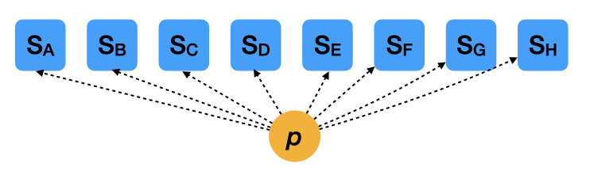
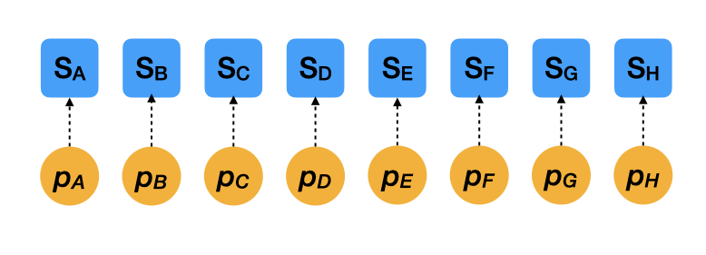
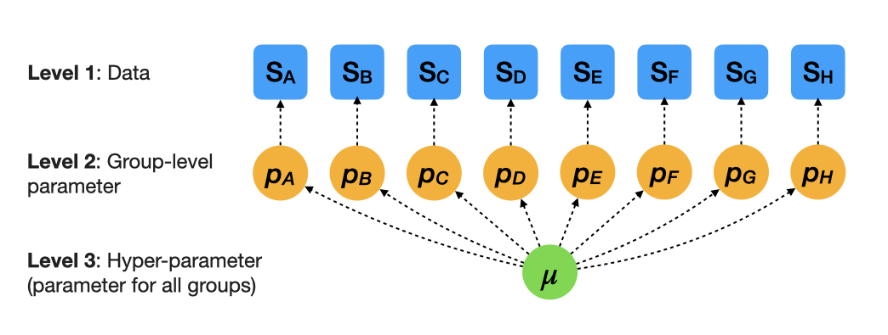
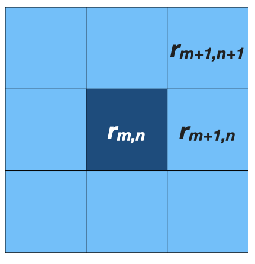

<!--
DAY 3 SEQUENCE: lecture results -> intercept-only model/code -> model checking
-> regression. Explain pooling and connect equations to supplied Stan code.
Code execution is optional. Stored results support the offline route.
CNDD regression curves/code are conceptual; allometry is optional reference.
-->


```{r setup, include=FALSE}
source(here::here("R/slides_setup.R"))
trees <- make_tree_data()
fit <- course_fit("day3_trees")
comparison <- mother_comparison(fit, seed = 42)
tree_a <- comparison |>
  filter(tree == "A") |>
  select(tree, n, model, mean) |>
  pivot_wider(names_from = model, values_from = mean) |>
  left_join(trees |> select(tree, p_true), by = "tree")
```

##  {#title-slide background="../images/priors.png" background-size="50%" background-position="50% 20%"}

::: title-box
<h2>Bayesian statistics for ecology</h2>
<h3>Day 3: Hierarchical models</h3>
<p>AFEC-X 2026 · 23 October</p>
<h3>Masatoshi Katabuchi @ XTBG, CAS</h3>
:::

## Survival, density and group differences

- Day 1: uncertainty about a survival probability.
- Day 2: survival probability changes with conspecific density.
- Today: estimate each group using its own data and data from other groups.

::: notes
We first leave out the density predictor and use a separate data set to make the
idea of information sharing easier to see. We return to species CNDD later.
:::

## Today's progression

1. **Survival probabilities:** estimate differences among eight mother trees.
   We start without a density effect.
2. **Regression relationships:** extend the same idea to differences in intercepts and slopes among species.

A **hierarchical model** uses data from all groups to estimate each group's parameters.

::: small
**Core:** mother-tree pooling and the three regression structures.\
**Optional reference:** a full second analysis, new fitting and allometry.
:::

::: notes
First use the mother-tree binomial model with no density predictor to focus on
information sharing. Later extend the hierarchy to regression coefficients.
This is a progression in model structure, not a claim that the first model falls
outside the regression framework. Mother-tree data are different from Day 2's
quadrats. Species CNDD is a conceptual illustration; the allometry example uses
its own simulated data and saved hierarchical regression fit.
:::

## Today's objectives

**Understanding Bayesian hierarchical models**

- Explain how data from other groups can help estimate each group's survival.
- Identify the likelihood, shared prior and survival probabilities in supplied code.
- Compare survival estimates and their uncertainty with and without information sharing.
- Explain how the same idea extends to species-specific regression relationships.

## Eight mother trees: one overall survival rate?

::: columns
::: {.column width="42%"}
```{r tree-data}
trees |>
  select(tree, n, suv) |>
  knitr::kable(
    format = "html",
    col.names = c("Tree", "Seedlings", "Survivors")
  ) |>
  kableExtra::kable_styling(font_size = 27)
```
:::
::: {.column width="58%"}

We followed seedlings under eight mother trees of one species.

What if we combine all seedlings into one group?

```{r pooled-proportion, echo=TRUE}
sum(trees$suv) / sum(trees$n)
```

One overall observed survival proportion: **`r round(sum(trees$suv) / sum(trees$n), 3)`**.
:::
:::

::: notes
Start with the concrete calculation from main.qmd, using newly simulated
mother-tree data (seed 42), different from Day 2's quadrats. The result is a
pooled observed proportion, also the common-probability binomial MLE; it is not
a posterior mean. Ask what differences among trees this one number hides.
Do not introduce the hypothetical 0/2 and 2/2 cases here.
:::

## Eight mother trees: estimate each tree separately?

::: columns
::: {.column width="48%"}
```{r separate-proportions}
trees |>
  transmute(
    Tree = tree,
    Seedlings = n,
    Survivors = suv,
    Proportion = round(suv / n, 2)
  ) |>
  knitr::kable(format = "html") |>
  kableExtra::kable_styling(font_size = 25)
```
:::
::: {.column width="52%"}

For each mother tree:

Survival proportion = survivors / seedlings.

The proportions range from **`r round(min(trees$suv / trees$n), 2)`** to **`r round(max(trees$suv / trees$n), 2)`**.

Do these differences reflect real tree differences, sampling variation, or both?
:::
:::

::: notes
Calculate the proportions before naming the models. They are separate binomial
MLEs, not the separate posterior means shown after the exercise. Different
observed proportions alone do not establish different underlying probabilities.
:::

## One common probability, or different probabilities?

```{r observed-trees, fig.width=11, fig.height=4.2}
ggplot(trees, aes(tree, suv / n, size = n)) +
  geom_hline(
    yintercept = sum(trees$suv) / sum(trees$n),
    linetype = "dashed",
    colour = "grey40"
  ) +
  geom_point(shape = 21, fill = "white", stroke = 1.2) +
  ylim(0, 1) +
  labs(
    x = "Mother tree",
    y = "Observed survival\nproportion",
    size = "Seedlings",
    subtitle = "Points: tree-specific proportions. Dashed line: pooled proportion."
  )
```

Can data from other trees help us estimate each tree's survival probability?

::: notes
Each point is one mother tree; point size is its seedling count.
The dashed line is the pooled observed proportion, not a fitted regression line.
Neither all differences being real nor all trees being identical follows from
this plot. Use this question to motivate the two extreme models and their
hierarchical alternative. Show fitted comparisons and generating probabilities
later in the lecture, before the model-reading activity.
:::

## Complete pooling

::: columns
::: {.column width="68%"}
{width=100% style="height: auto;"}
:::
::: {.column width="32%"}

$$s_j\sim\operatorname{Binomial}(n_j,p)$$

Every mother tree shares the same $p$.

What ecological difference does this assumption leave out?
:::
:::

::: notes
j indexes mother trees. Our comparison uses p ~ Beta(1,1), the flat Day 1 prior.
An uncertainty interval for a common p does not represent between-tree variation.
:::

## Separate estimation

::: columns
::: {.column width="68%"}
{width=100% style="height: auto;"}
:::
::: {.column width="32%"}

$$s_j\sim\operatorname{Binomial}(n_j,p_j)$$

Each mother tree has its own independent $p_j$.

How much can a tree with few seedlings tell us on its own?
:::
:::

::: notes
Our comparison uses independent Beta(1,1) priors. What we learn about tree A
does not update the probability for tree B. Small data can give wide intervals.
:::

## Information sharing through a prior

::: columns
::: {.column width="55%"}
{width=100% style="height: auto;"}
:::
::: {.column width="45%"}

**Likelihood**
$$s_j\sim\operatorname{Binomial}(n_j,p_j)$$

**Shared prior for tree effects**
$$\operatorname{logit}(p_j)\mid\mu,\sigma\sim\mathcal{N}(\mu,\sigma)$$

**Hyperpriors**
$$\begin{aligned}
\mu&\sim\mathcal{N}(0,5)\\
\sigma&\sim\operatorname{HalfNormal}(0,1)
\end{aligned}$$
:::
:::

**Day 2:** prior scales were specified. **Today:** the shared centre and
between-tree SD are unknown too; we estimate them with priors.

::: notes
Allow about one minute for the bridge from Day 2, within the existing pooling
explanation. Day 2 used specified Normal(0,2.5) priors for regression coefficients.
Here the shared Normal distribution describes how biologically comparable tree
effects vary; its centre and SD are unknown. Hyperpriors describe uncertainty
about those shared parameters. Their numerical scales are specified, just as
the coefficient-prior scales were on Day 2.
All eight trees inform mu and sigma, connecting their posterior tree estimates.
The model estimates tree effects and shared parameters jointly; it does not
estimate a prior in a separate step and reuse the data as independent evidence.
The conditional tree effects are independent given mu and sigma in this model.
The Normal second argument is SD, on the logit scale. These hyperpriors match
stan/logistic.stan and the saved fit; do not substitute main.qmd's half-Cauchy.
The next slide interprets sigma on the probability scale. Shorten repeated code
explanation if needed; do not add a new activity or a prior-fitting demonstration.
:::

## How much can mother trees differ?

::: columns
::: {.column width="65%"}
```{r group-variation, fig.width=8.8, fig.height=5.2, out.width="100%", dev.args=list(bg="white")}
plot_group_curves() +
  labs(
    subtitle = "Same logit centre; only sigma changes",
    caption = "Eight colours: eight trees. Illustrative curves, not fitted."
  ) +
  theme(plot.margin = margin(5.5, 22, 5.5, 5.5))
```
:::
::: {.column width="35%"}
```{r group-sd-prior, fig.width=4.6, fig.height=3.6, out.width="100%", dev.args=list(bg="white")}
sigma_examples <- tibble(sigma = c(.1, 1, 3))
tibble(sigma = seq(0, 3.5, length.out = 701)) |>
  mutate(density = 2 * dnorm(sigma, mean = 0, sd = 1)) |>
  ggplot(aes(sigma, density)) +
  geom_vline(
    data = sigma_examples,
    aes(xintercept = sigma),
    linetype = "dashed",
    colour = "grey55",
    linewidth = .6
  ) +
  geom_line(colour = "#d95f02", linewidth = 1.2) +
  geom_point(
    data = sigma_examples,
    aes(y = 2 * dnorm(sigma, mean = 0, sd = 1)),
    colour = "#d95f02",
    size = 3
  ) +
  scale_x_continuous(
    limits = c(0, 3.5),
    breaks = c(.1, 1, 3),
    expand = expansion(mult = .04)
  ) +
  scale_y_continuous(limits = c(0, .85), breaks = c(0, .4, .8)) +
  labs(
    title = "Prior for sigma",
    subtitle = "Half-Normal(0, 1)",
    x = expression(sigma),
    y = "Prior density"
  ) +
  theme(
    axis.title = element_text(size = 20),
    axis.text = element_text(size = 18),
    plot.title = element_text(size = 23),
    plot.subtitle = element_text(size = 19)
  )
```

$\sigma$ describes differences among trees.
We estimate $\sigma$ from the data, with a prior.

:::
:::

::: notes
Read both figures together: the three dashed lines in the prior
plot mark sigma = 0.1, 1 and 3, the values used for the three panels on the left.
The prior is a distribution over sigma, not a fourth mother-tree curve or a
posterior. A sigma value and a prior distribution for sigma are different things.
The model estimates sigma with a half-Normal(0,1) prior; it is not fixed at 1.

The left panels are hypothetical illustrations, not fitted mother-tree posteriors.
Fix the group logit centre at mu=0 and use the same eight standard Normal quantiles.
Only sigma changes. Each coloured curve has illustrative within-tree logit SD 0.2;
this extra width is a visual aid, not another level in the fitted model.
Use the Jacobian 1/[p(1-p)] to convert logit densities to the probability scale,
then scale each curve to peak 1. Relative density areas cannot be compared.
Probability-scale modes need not equal plogis of the group logit centres.
Greater inferred group variation generally permits less sharing for comparable data;
these panels do not themselves show fitted shrinkage.
The actual model estimates mu with Normal(0,5) prior; mu=0 is fixed only here.
Keep alternative priors in the optional reference. Do not replace the saved model's
half-Normal prior with main.qmd's older half-Cauchy prior.
:::

## What information does each tree provide?

```{r prediction-table}
trees |>
  select(tree, n, suv) |>
  mutate(proportion = round(suv / n, 2)) |>
  knitr::kable(format = "html") |>
  kableExtra::kable_styling(font_size = 25)
```

Read the seedling counts and survival proportions together.

::: notes
Lecture comparison, before the model/code walkthrough.
Ask which trees have little information and which observed proportions are
extreme. Use these observations to interpret the next two figures together.
This is a brief lecture prompt, not the participant activity.
:::

## Three ways of estimating survival {.mother-story}

```{r fitted-trees, fig.width=12, fig.height=5.1, dev.args=list(bg="white")}
plot_mother_comparison(comparison)
```

Points: posterior means. Intervals: 95% credible.<br>
Rows ordered by Separate estimates; n = seedlings.

::: notes
Complete and separate models use Beta(1,1) probability priors, whereas partial
pooling uses the Normal logit group prior with estimated centre and SD.
State this difference. It is an illustrative model comparison, not an isolation
of pooling under identical marginal priors. All code and priors are in the handout.
The grey line and ribbon show the single complete-pooling posterior, shared by
all trees. Only separate and partial estimates are repeated by tree. The grey
line is a comparison reference, not the exact target of hierarchical shrinkage.
Rows are ordered by the separate posterior means, with the largest at the top.
n is the seedling count. Separate and Partial pooling are vertically dodged
within each tree so their 95% intervals can be compared. Separate is always an
open purple circle; Partial pooling is always a filled orange circle. The next
slide retains those encodings and reveals the generating probabilities on a
1:1 scatterplot. The separate model is the no-pooling model from earlier.
:::

## Does sharing information improve the estimates? {#in-a-simulation-we-can-check-against-the-truth .mother-story}

```{r tree-truth-comparison, fig.width=8, fig.height=6.4, out.width="588px", out.height="470px", dev.args=list(bg="white")}
plot_mother_truth(comparison, trees, highlight = "A", limits = c(.2, .5))
```

**Tree A: `r sprintf("%.2f", tree_a$Separate)` → `r sprintf("%.2f", tree_a$Partial)`; true probability = `r sprintf("%.2f", tree_a$p_true)`.**<br>
Arrows: Separate → Partial pooling. Dashed diagonal: estimate = truth.

::: notes
Read x as the generating probability and y as the posterior mean.
The square panel has identical axis scales; its dashed 1:1 line represents
agreement with the truth. Vertical connections show the direction and amount
of movement from Separate to Partial pooling. The connections are drawn behind
the points. Each tree's true probability is explicitly joined by tree ID,
not by row order. F has true p=0.25 and D has true p=0.36. Several trees share
the same true probability, so some trajectories overlap.
Both axes are restricted to 0.2–0.5; Tree G estimates fall below this window.

Follow labelled Tree A: n=`r tree_a$n`, separate posterior mean
`r sprintf("%.2f", tree_a$Separate)`, partial-pooling mean
`r sprintf("%.2f", tree_a$Partial)` and generating probability
`r sprintf("%.2f", tree_a$p_true)`.
Movement depends on n, extremity and the inferred group distribution.
Separate points remain posterior means under independent Beta(1,1) priors,
not observed proportions or MLEs. Do not claim that sharing information always
improves every estimate or that one simulated data set
establishes general performance. In real data, truth is unknown. Use this comparison as a visual illustration, not an exact error calculation.
Read these results before the activity. If short of time, focus on Tree A
and the point that information sharing does not guarantee improvement.
:::

## Read the model behind these results {background-color="#f3e8f5"}

`day3/exercise-student.qmd`

- Connect the observed counts to Stan's data.
- Find the likelihood and the shared distribution of intercepts.
- Connect posterior intercepts to survival probabilities.
- Explain the information-sharing assumption in one sentence.

Read supplied code; running the R chunks is optional.

::: notes
The lecture has already shown the comparison and truth figures. Use the
handout to connect those results to the full model and analysis code.
The handout shows compilation/sampling as well as a saved-result route;
participants can read either without running a new fit. Then read diagnostics
and explain the replicated-count check before returning to regression.
:::

## Can the model reproduce the observed counts?

$$\widetilde{s}_j\sim\operatorname{Binomial}(n_j,p_j),\qquad
p_j\text{ drawn from the posterior}$$

```{r mother-check, fig.width=12, fig.height=4.0}
plot_mother_check(fit)
```

Keep each tree's seedling count fixed.<br>
Orange intervals describe replicated **counts**, not uncertainty in a probability.

::: notes
This is the mother-tree intercept-only model from the handout, before adding
a density predictor. For each posterior draw, generate binomial survivor counts
using the observed n_j and sampled p_j. Open circles are observed survivor counts;
orange points/intervals show replicated-count medians and 95% predictive intervals.
Read the generation and plotting code in the handout alongside this figure.
It checks compatibility with observations, not MCMC convergence. Numerical
sampling diagnostics and traces are covered separately in the same handout.
Inspect which trees look poorly reproduced, while recognizing that agreement
in this in-sample check does not establish adequacy of every model assumption.
:::

## From an intercept-only model to regression

::: columns
::: {.column width="45%"}

**So far: intercept only**

$$\operatorname{logit}(p_j)=\alpha_j$$

**Now: intercept + density effect**

$$\operatorname{logit}(p_{ij})=\alpha_j+{\color{#d95f02}{\beta_j x_{ij}}}$$

:::
::: {.column width="55%"}

```{r species-cndd, fig.width=8, fig.height=5.1}
plot_cndd_species()
```

:::
:::

**We can share information about these coefficients, too.**

::: footer
Conceptual simulation inspired by [Comita et al. 2010](https://doi.org/10.1126/science.1190772)
and [Song & Katabuchi et al. 2024](https://doi.org/10.1002/ecy.4382).
:::

::: notes
Model progression and selected code. The main transition is from a model without a density predictor
to a regression that includes density, not from mother trees to species.
Strictly, the earlier model is already an intercept-only logistic regression.

So far, each group had one survival probability. We did not include a predictor
that could explain variation in survival within a group. Now bring back Day 2's
question: how does survival change with conspecific density? Adding density
gives each group a curve, with an intercept and a density coefficient.
The orange term is the addition to the model. i indexes observations within
group j, and x_ij is scaled conspecific density. Both models retain a binomial
observation model (or Bernoulli for individual seedlings).

The information-sharing idea still applies: group regression coefficients can
be connected through shared distributions. Their hyperparameters also need
priors in a full model. The curves alone do not demonstrate fitted pooling.

For this application the groups are species rather than mother trees. Each
coloured curve represents a species. This is the seeded conceptual example
from main.qmd, not fitted species effects for Day 2's data or a numerical
reproduction of either paper. It uses a different simulated data set, and does
not add density to the eight mother-tree data.
:::

## First: varying intercepts, a common slope

Species can differ in baseline survival while sharing a density coefficient.

$$\operatorname{logit}(p_{ij})=\alpha_j+\beta x_{ij}$$

Selected model lines:

```stan
alpha ~ normal(mu_alpha, sigma_alpha);
suv[i] ~ binomial_logit(
  n[i], alpha[group[i]] + beta * x[i]
);
```

The index on `alpha` changes the intercept used for each observation.
`beta` is shared by all species.

::: notes
A conceptual CNDD extension, not executable code for the saved mother-tree fit.
Declarations, loops and the remaining priors are omitted from these selected
lines. group[i] maps observation i to species j, x is scaled density, n is the
seedling count and suv is the survivor count. The likelihood is still binomial.
The Normal group prior is shown in centered form so the model structure is easy
to read; an equivalent non-centered representation can also be used.
These curves need not be parallel on the probability scale. The shared slope
is a common change in log-odds per unit density. Do not introduce a new fit.
This is the idea in section 4 of the original exercise.qmd, adapted from
Normal log-height regression to binomial survival regression.
:::

## Then: varying intercepts and slopes

Species may also differ in their response to density.

$$\operatorname{logit}(p_{ij})=\alpha_j+\beta_j x_{ij}$$

```stan
alpha ~ normal(mu_alpha, sigma_alpha);
beta ~ normal(mu_beta, sigma_beta);
suv[i] ~ binomial_logit(
  n[i], alpha[group[i]] + beta[group[i]] * x[i]
);
```

Both coefficients vary by species and have shared group distributions.

::: notes
Selected conceptual model lines, with declarations, loops and hyperpriors
omitted. For this first explanation, the intercept and slope distributions are
conditionally independent given their hyperparameters. Correlated group effects
are an optional extension; do not claim this excerpt is identical to vslope.stan,
which uses a multivariate, non-centered parameterization with correlations.
Ask: what changed from beta to beta[group[i]], and where is information shared?
No participant implementation is required. This is the model idea in original
exercise.qmd section 6; Cholesky/LKJ derivations are outside the core session.
:::

## Can abundance explain slope differences?

The expected density coefficient can depend on species abundance $a_j$.

$$\beta_j\sim\mathcal{N}(\gamma_0+\gamma_1 a_j,\tau_\beta)$$

```stan
beta[j] ~ normal(
  gamma0 + gamma1 * abundance[j], tau_beta
);
```

Density varies among observations. Abundance describes the species.
The group model still allows unexplained differences among species.

::: notes
i indexes seedlings and j species here. The response is Bernoulli per seedling,
or binomial when counts share the same predictors. a_j is scaled species abundance.
The group SD tau_beta and all coefficients require priors in a full analysis.
This extends the varying-slope model: a group-level predictor explains its
expected slope, while tau_beta describes remaining between-species variation.
This is the model idea in original exercise.qmd section 7. The code is a
conceptual excerpt, not a new fitted research model or implementation exercise.
:::

## A species-level relationship

```{r species-abundance, fig.width=11, fig.height=4.5}
plot_cndd_abundance()
```

What would this relationship imply about species differences?

::: notes
Simulated coefficients, with the generating line shown. Higher coefficients
here mean less negative slopes. A logit coefficient is not a fixed probability
difference, which also depends on baseline survival and the densities compared.
The model asks about an association. It alone does not establish the cause of rarity.
:::

## Ecological reasons to share information

Which trees or species should share information in a hierarchical model?

- Groups should be biologically comparable.
- Species traits can explain systematic differences among groups.
- Partial pooling depends on assumptions about how groups vary.

::: notes
A hierarchical model is not automatically appropriate because a grouping label
exists. Discuss shared habitat, census interval and missing predictors.
:::

## Three days of Bayesian thinking

- A posterior expresses uncertainty conditional on data and assumptions.
- Predictions put that uncertainty on the scale of an ecological question.
- Hierarchical priors share information while allowing groups to differ.
- Computation, model-generated data and ecological context all inform interpretation.

# Optional reference {visibility="uncounted"}

## Priors can also express spatial similarity {visibility="uncounted"}

::: columns
::: {.column width="35%"}
{width=100%}
:::
::: {.column width="65%"}

Nearby quadrats may share unmeasured habitat conditions.

- A spatial effect represents residual differences among locations.
- A joint prior can express stronger similarity between effects at nearby locations.
- The strength and spatial scale of that similarity also need assumptions and priors.

Group priors express commonality among trees; spatial priors can express
commonality related to location.
:::
:::

::: small
Research extension only; no spatial model is fitted in this course.
:::

::: notes
Optional connection to main.qmd's spatial-prior example; omit when time is short.
The image illustrates neighbourhoods, not observed spatial effects. A spatial
prior is an assumption about latent effects, not a claim that neighbouring
observations must be equal. Habitat predictors may account for some structure;
the residual spatial effect addresses remaining dependence under the model.
Unlike the conditionally independent mother-tree effects, a spatial joint prior
can encode dependence that varies with distance. A Gaussian process is one
example; no covariance formula or implementation is required here.
Do not restore the old eight-neighbour conditional equation as a complete model:
boundary rules, a coherent joint distribution and any constraints must be defined.
Source: Stan User's Guide, Gaussian Processes.
:::

## Allometry and wood density {visibility="uncounted"}

::: columns
::: {.column width="52%"}
```{r allometry-curves, fig.width=8, fig.height=4.6}
allo <- make_allometry_data()
ggplot(allo, aes(dbh, h, colour = sp)) +
  geom_point(alpha = .6) +
  labs(x = "DBH (cm)", y = "Height (m)") +
  guides(colour = "none")
```
:::
::: {.column width="48%"}

**Individual level:** DBH predicts height.

**Species level:** wood density may predict the allometric exponent.

$$h=a\,\mathrm{DBH}^{b}$$
:::
:::

::: notes
Optional second research connection.
The data are simulated. Explain the power-law shape visually, without a new
transformation or coefficient exercise. Inspiration follows main.qmd's research
example; its unpublished citation status has not been independently established.
:::

## The same structure with a different response {visibility="uncounted"}

```{r wood-density, fig.width=11, fig.height=4.5}
plot_wood_density()
```

The response changes to log height. Species still share information through a group model.

::: notes
The figure uses day3_vslope, fitted to the existing simulated allometry data.
Points summarise species exponents and the line summarises their expected value
at each wood density, with 95% intervals. It is not evidence from a real forest.
Skip these two slides if delayed. Detailed transformation and implementation are optional.
:::

## Alternative priors for group variation {visibility="uncounted"}

```{r group-sd-priors, fig.width=13, fig.height=4.2, dev.args=list(bg="white")}
plot_group_sd_priors()
```

The fitted model uses Half-Normal(0,1). The others are optional comparisons.

::: notes
This changes the prior distribution for sigma, rather than fixing sigma at a
particular value. All curves share the same axes and are normalized by twice
the symmetric density for sigma >= 0. Wider and heavier-tailed priors have mass
beyond the displayed range. No refit was performed for these comparison curves.
Skip this slide in the core explanation.
:::

## The completed model and its assumptions {visibility="uncounted"}

Selected lines from `stan/logistic.stan`:

```stan
mu ~ normal(0, 5);
sigma ~ std_normal();  // sigma is constrained to be positive
z_tilde ~ std_normal();
z = mu + sigma * z_tilde;
// For every mother tree i:
suv[i] ~ binomial_logit(N[i], z[ii[i]]);
```

Data: seedlings and survivors. Unknowns: tree effects, group centre and group SD.

::: notes
These lines come from stan/logistic.stan, shown together for reading. z is a
transformed parameter and sigma has lower bound zero. Read the complete file
in the handout. No independent coding or non-centred parameterisation lesson.
Priors: mu Normal(0,5), sigma half-Normal(0,1). z_tilde is standard Normal.
:::

## A new mother tree {visibility="uncounted"}

```{r echo=TRUE, eval=FALSE}
set.seed(20261026)
draws <- fit$draws
p_new <- plogis(rnorm(nrow(draws), draws$mu, draws$sigma))
quantile(p_new, c(.025, .5, .975))
```

This predicts a new tree's probability, including group variation. A future
survivor count would also require a seedling count and binomial sampling.

## References {visibility="uncounted"}

- [Comita et al. 2010, Science](https://doi.org/10.1126/science.1190772)
- [Song & Katabuchi et al. 2024, Ecology](https://doi.org/10.1002/ecy.4382)
- [Stan User's Guide: hierarchical logistic regression](https://mc-stan.org/docs/stan-users-guide/regression.html#hierarchical-logistic-regression)
- [Stan User's Guide: predictive checks](https://mc-stan.org/docs/stan-users-guide/posterior-predictive-checks.html)
- [Stan User's Guide: Gaussian processes](https://mc-stan.org/docs/stan-users-guide/gaussian-processes.html)
